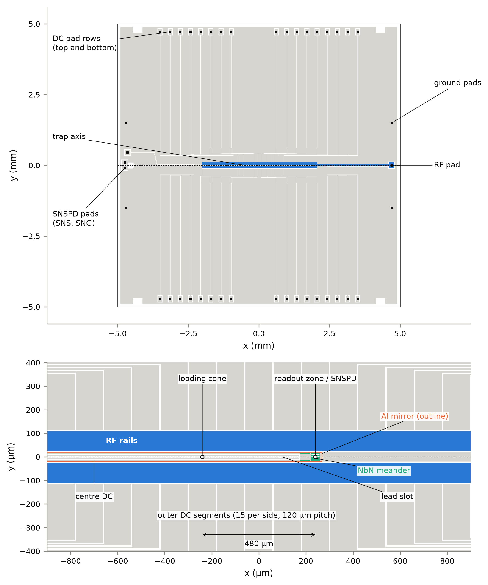
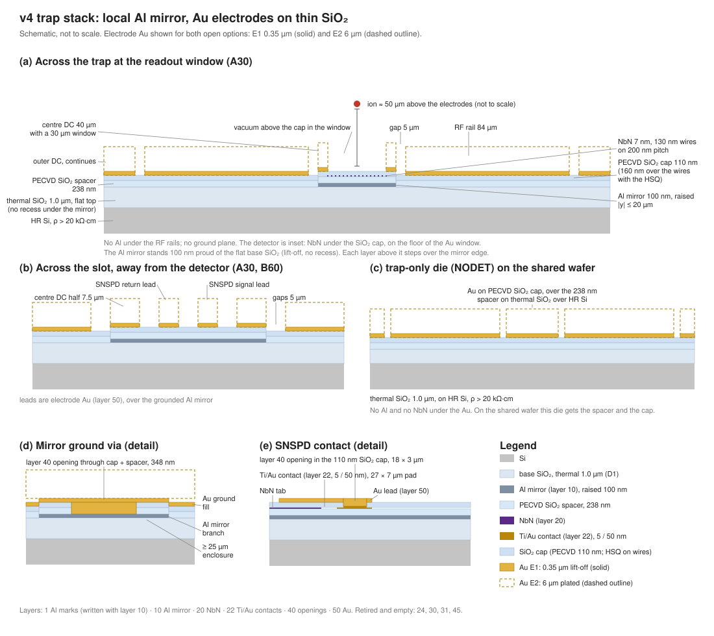

> **Claude-authored.** Start page: a map of the chip design package, with its key numbers, decisions, open items, tests and links, 2026-11-10.

# Start here

[Glossary](GLOSSARY.md) · [Decisions](../notes/decisions.md) · [Open decisions](fab/OPEN_DECISIONS.md) · [Simulation index](sim/INDEX.md) · [Fab overview](fab/README.md) · [Test plan](fab/test_plan.md) · [RF primer](primers/RF_PRIMER.md) · [Progress](../CLAUDE_PROGRESS.md)

## The chip in five lines

- The chip traps one ¹³⁸Ba⁺ ion at a target height of 50 µm and detects its 493 nm fluorescence ([progress goal table](../CLAUDE_PROGRESS.md)).
- The detector is an NbN superconducting nanowire single-photon detector (SNSPD, [glossary](GLOSSARY.md#acronyms)) under the readout zone. The loading zone and the readout zone are 480 µm apart.
- The electrodes are two RF rails, a centre DC electrode (electrode 2) and segmented outer DC electrodes on a 10 × 10 mm die ([CLAUDE.md](CLAUDE.md), "What this folder is").
- The materials are Au electrodes on about 1.3 µm of SiO₂ over high-resistivity Si, with a local Al mirror under the SNSPD and its leads only ([CLAUDE.md](CLAUDE.md), "Key design numbers").
- The chip is built as small R&D runs at MIT.nano. The first run, R1_TRAP, is trap only, with no detector ([progress](../CLAUDE_PROGRESS.md), deliverables).

Labels used above: **A30** is the trap die with a 30 × 30 µm detector window; **B60** has a 60 × 30 µm window; **NODET** is the die with no detector ([glossary](GLOSSARY.md#dies-and-runs)); **E1** (0.35 µm evaporated Au) and **E2** (6 µm plated Au) are the two electrode options, and the team has not chosen between them ([glossary](GLOSSARY.md#electrode-options-and-versions)).

## What it looks like

What you are looking at: the whole 10 × 10 mm die with its pad rows, RF pad and SNSPD pads (top), and the zones, RF rails, centre DC, lead slot and 480 µm spacing (bottom).

What you are looking at: the layers at the readout window, from the Si substrate up to the Au electrodes, with the 100 nm Al mirror inlaid in the SiO₂.

## The numbers that define it

| Quantity | Value | Where it comes from |
|---|---|---|
| Ion and wavelength | ¹³⁸Ba⁺, 493 nm detection | [progress goal table](../CLAUDE_PROGRESS.md) |
| Ion height | 49.97 µm (loading), 49.98 µm (readout), planar model; over the A30 window the drop is 1.19 µm (E2), ≤ 0.37 µm (E1) | [sim/out/12_final_chip/trap_die_v4_A30/summary.json](sim/out/12_final_chip/trap_die_v4_A30/summary.json) (`loading.null_z`, `readout.null_z`, `readout.dh_recess`); E1 bound from [trap_die_v4_A30_E1/summary.json](sim/out/12_final_chip/trap_die_v4_A30_E1/summary.json) |
| RF drive | 53 V at 28 MHz; radial ~3.0 MHz, q 0.30, depth ≈ 52 meV | [CLAUDE.md](CLAUDE.md), "Key design numbers" |
| Axial frequency and DAC range | 0.8 MHz; ±10 V DACs | [CLAUDE.md](CLAUDE.md), "Key design numbers" |
| Zone spacing and segment pitch | 480 µm (zones at x = −240 and +240 µm); 15 + 15 segments at 120 µm pitch | [CLAUDE.md](CLAUDE.md), "Key design numbers" and "Conventions" |
| Loading zone voltage, 10° tilt | 7.5 V (A30); 7.9 V (NODET) | [trap_die_v4_A30/summary.json](sim/out/12_final_chip/trap_die_v4_A30/summary.json) (`loading.vmax`); [trap_die_v4_NODET/summary.json](sim/out/12_final_chip/trap_die_v4_NODET/summary.json) (`loading.vmax`) |
| Readout zone voltage, 10° tilt | 6.3 V (A30); 2.2 V (B60) | [trap_die_v4_A30/summary.json](sim/out/12_final_chip/trap_die_v4_A30/summary.json) (`readout.vmax`); [trap_die_v4_B60/summary.json](sim/out/12_final_chip/trap_die_v4_B60/summary.json) (`readout.vmax`) |
| Transport, centre DC at 0 V | Max \|V\| 6.6 V; largest 10 µm step 1.71 V | [trap_die_v4_A30_V2zero/summary.json](sim/out/12_final_chip/trap_die_v4_A30_V2zero/summary.json) (`transport.max_abs_V`, `transport.max_step_change_V`); cross-checked in [sim/21](sim/out/21_transport_waveform/trap_die_v4_A30_V2zero/summary.json) |
| Detector geometry | Meander 130 nm wide on 200 nm pitch, 160 lines; line 36 µm (A30) / 69 µm (B60); window 30 × 30 µm (A30), 60 × 30 µm (B60) | [CLAUDE.md](CLAUDE.md), "Key design numbers"; [CLAUDE_PROGRESS.md](../CLAUDE_PROGRESS.md), deliverables |
| Geometric collection, E2 | A30 2.22 %; B60 4.16 % of emitted 493 nm photons | [sim/out/15b_collection_v4/summary.json](sim/out/15b_collection_v4/summary.json) (`cases.A30_E2_null+drop.collection_pct`, `cases.B60_E2_null+drop.collection_pct`) |
| Absorbed fraction, E2, 160 nm cap | A30 1.47 %; B60 2.71 % of all emitted photons | [sim/out/15b_collection_v4/summary.json](sim/out/15b_collection_v4/summary.json) (`caps.160.absorbed_of_emitted_pct`) |
| NbN absorption, 160 nm SiO₂ cap | 0.66 (effective-medium theory) | [sim/out/09c_localmirror_optics/summary.json](sim/out/09c_localmirror_optics/summary.json) (`v4_best_cap_spacer238.A`) |
| RF pickup in the nanowire | 0.96 µA (E2); 1.92 µA (E1); 2-D bound | [sim/out/10c_mirror_thickness/summary.json](sim/out/10c_mirror_thickness/summary.json) (`al100_inlaid.E2.window.I_pk_uA`, `al100_inlaid.E1.window.I_pk_uA`) |
| Chip RF capacitance, A30 | 2.59 pF on E2; 2.39 pF on E1; Si treated as lossless (the cold case) | [sim/out/22_rf_capacitance/summary.json](sim/out/22_rf_capacitance/summary.json) (`configs.A30_E2.chip.C_chip_pF`, `configs.A30_E1.chip.C_chip_pF`) |
| Die size | 10 × 10 mm | [CLAUDE.md](CLAUDE.md), "Conventions" |

## What the team decided

| Date | Decision | The team's reason | Status |
|---|---|---|---|
| 2026-11-02 | Five-wire trap for ¹³⁸Ba⁺ with NbN SNSPD, Au electrodes, Al ground plane, about 5 K | Not recorded for ion or substrate; notes give reasons for ground-plane flow, detector shield and plated Au | Partly superseded: ground plane became a local mirror (2026-11-08) |
| 2026-11-02 | Separate loading zone, readout zone above the SNSPD | "not sure if it is safe to blast the SNSPD with a bunch of atoms" | Stands (spacing 480 µm, 2026-11-08) |
| 2026-11-02 | High-resistivity Si substrate | "low RF loss, and it is NIST practice" | Stands (ρ > 20 kΩ·cm, 2026-11-08) |
| 2026-11-02 | Ion height 50 µm; height may differ between zones | Height policy: the cut-out over the SNSPD lowers the ion there. 50 µm: not recorded at the time | Stands (kept 2026-11-09) |
| 2026-11-02 | Plain diced square chip, no bowtie | "simpler fab" | Superseded by the narrow die, then the 10 × 10 mm die |
| 2026-11-02 | Narrow 10 × 2.5 mm die | The corner layout was "lopsided and wasteful" | Superseded by the 10 × 10 mm die (2026-11-07) |
| 2026-11-02 | NODET die (trap, no SNSPD) | Reason not recorded | Stands (R1_TRAP die) |
| 2026-11-02 | Fabricate as small R&D runs at MIT.nano | "make several chips at a time to speed up fabrication" | Stands |
| 2026-11-02 | Process: ground-plane flow, plated Au electrodes | "a simpler design we could go for, ... in between difficulty of a pure single layer trap vs actual multilayering" | Superseded (2026-11-08, local mirror) |
| 2026-11-02 | SNSPD material: NbN, e-beam patterned | "the detector needs a T_c well above the ~5 K operating temperature ("anything over 7K")" | Stands |
| 2026-11-02 | SNSPD protection: SiO₂ cap, Al ground plane, grounded ITO window | "against laser scatter, RF pickup and dielectric charging" | Superseded in part (ITO removed 2026-11-07; Al replaced 2026-11-08) |
| 2026-11-02 | First run is trap only (R1_TRAP) | Reason not recorded | Stands |
| 2026-11-07 | Detector variants: A30, B60 and NODET | Reason not recorded | Stands (B60 kept 2026-11-08) |
| 2026-11-07 | No ITO anywhere | "switch to an Al mirror to implement the Hampel design" | Stands |
| 2026-11-07 | 10 × 10 mm trap die, trap centred, pads at the die edges | "to fit the lab's form factor" | Stands |
| 2026-11-08 | On-chip vias from the Au ground fill to the Al | "a mirror left floating by a missing bond is the worst case for RF pickup" | Stands (applied to the local mirror) |
| 2026-11-08 | Hampel's local mirror as a variant first | Reason not recorded | Superseded (same day, architecture entry) |
| 2026-11-08 | Architecture: local mirror, no 10 µm D2 | "with vacuum directly above the cap, the cap can be tuned as a matching layer"; "NIST traps without one on Si with ρ > 20 kΩ·cm" | Stands (mirror thickness changed 2026-11-09) |
| 2026-11-08 | Lead routing: slot along the centre DC | "it matches Hampel and puts the leads in a step the process already has" | Stands |
| 2026-11-08 | R1_TRAP follows the new architecture | "R1_TRAP should qualify the process the SNSPD dies will use" | Stands |
| 2026-11-08 | Detector allocation: A30 only, drop B60 | "The 60 µm window lowers the ion more"; "A larger exposed window floor has more area to become contaminated" | Reversed the same day |
| 2026-11-08 | Detector allocation: keep B60 | Reconsidered after the v4 numbers; "The team did not say which of these points decided it" | Stands |
| 2026-11-08 | Zone spacing 480 µm | "480 µm matches the laser setup the team has in its system now" | Stands |
| 2026-11-08 | Local mirror Al 450 nm thick | "lower the resistance of the mirror's path to ground" | Superseded (2026-11-09, 100 nm inlaid) |
| 2026-11-09 | Keep the 50 µm ion height | Adopted the DESIGN_LOG step 30 analysis: "Going to 40 µm with the same window gives 1.44× the light" | Stands |
| 2026-11-09 | Local mirror: 100 nm Al, inlaid | "We want the built electrodes to be the flat, coplanar geometry that every simulation assumes" | Stands; to be proven on witness W8 |

## What is still open

| Question | Options the repo names | Brief |
|---|---|---|
| Electrode Au | E1: 0.35 µm lift-off; E2: 6 µm plated | [E1 vs E2](fab/briefs/E1_vs_E2.md) |
| Readout radial tilt | Keep 10°; smaller tilt; zero tilt; wider DAC range | [readout tilt](fab/briefs/readout_tilt.md) |
| RF grounding / filters | Centre-DC filtering; carrier grounds; symmetric detector termination or cancellation; RF bypass at the SNSPD lead pads (v4) | brief in preparation |
| Pad pitch / beam access | 360 µm (current layout); 180, 240, 300, 400 µm | [pad pitch](fab/briefs/pad_pitch.md) |
| Carrier | PGA84L-like 84-pin; 100-pin CPGA; lab carrier | [carrier and spacer](fab/briefs/carrier_and_spacer.md) |
| Package spacer | Thickness ≥ approximately 0.6 mm [verify]; die-sized or larger; Si suggested | [carrier and spacer](fab/briefs/carrier_and_spacer.md) |

Largest open items from "Before any v4 run" that are not design choices:

- Inlaid mirror, witness loop W8 (recess, lift-off, hillocks): [qualification](fab/QUALIFICATION.md). Also see the [mirror brief](fab/briefs/mirror_raised_vs_inlaid.md).
- Facility questions for MIT.nano staff: [facility confirmations](fab/QUALIFICATION.md#facility-confirmations).
- Transport waveform hardware values tagged [verify]: DAC update rate 1 MHz, 16 bit over ±10 V, filter corners 50 kHz and 200 kHz ([sim 21 script](sim/21_transport_waveform.py), [DAC row](fab/tests/00_SETUP.md)).

## How it gets tested

- Room-temperature electrical tests: [01 electrical](fab/tests/01_ELECTRICAL.md).
- Cold detector tests: [02 cryogenic](fab/tests/02_CRYOGENIC.md).
- Readout chain: [03 readout](fab/tests/03_READOUT.md).
- Trapping checklist: [04 trapping](fab/tests/04_TRAPPING.md).
- Equipment and the questions for the lab: [00 setup](fab/tests/00_SETUP.md).
- What can replace the wafer-level test: [05 simpler testing](fab/tests/05_SIMPLER_TESTING.md).

## Where to go for...

| I want to... | Start at |
|---|---|
| understand a label | [GLOSSARY.md](GLOSSARY.md) |
| see why something was decided | [notes/decisions.md](../notes/decisions.md) |
| rerun or check a simulation | Set up the repo: [CLAUDE.md](CLAUDE.md), "Setting up the electrode repo". Then [sim/INDEX.md](sim/INDEX.md) |
| change a layout | [CLAUDE.md](CLAUDE.md), "Regenerating and checking" |
| follow the fabrication steps | [fab/TRAVELER.md](fab/TRAVELER.md), then [fab/RUNSHEET_R1_TRAP.md](fab/RUNSHEET_R1_TRAP.md) |
| plan a test | [fab/test_plan.md](fab/test_plan.md) |
| understand the RF and filtering background | [primers/RF_PRIMER.md](primers/RF_PRIMER.md) |
| find a figure for the report | [figures/README.md](figures/README.md) |
| see what changed and when | [DESIGN_LOG.md](DESIGN_LOG.md) (read the latest steps first), and [CLAUDE_PROGRESS.md](../CLAUDE_PROGRESS.md) |

## How this repo is written

- Claude-authored pages are labelled with a "Claude-authored" line and live in `design/`.
- The team's decisions are only in [notes/decisions.md](../notes/decisions.md).
- Tags: `[verify]` = not checked on the tool or against the source; `[team calc]` = computed for this project; `[inference]` = reasoning, not data.
- Numbers in the current-state pages are checked against the simulation outputs by [check_numbers.py](check_numbers.py).
