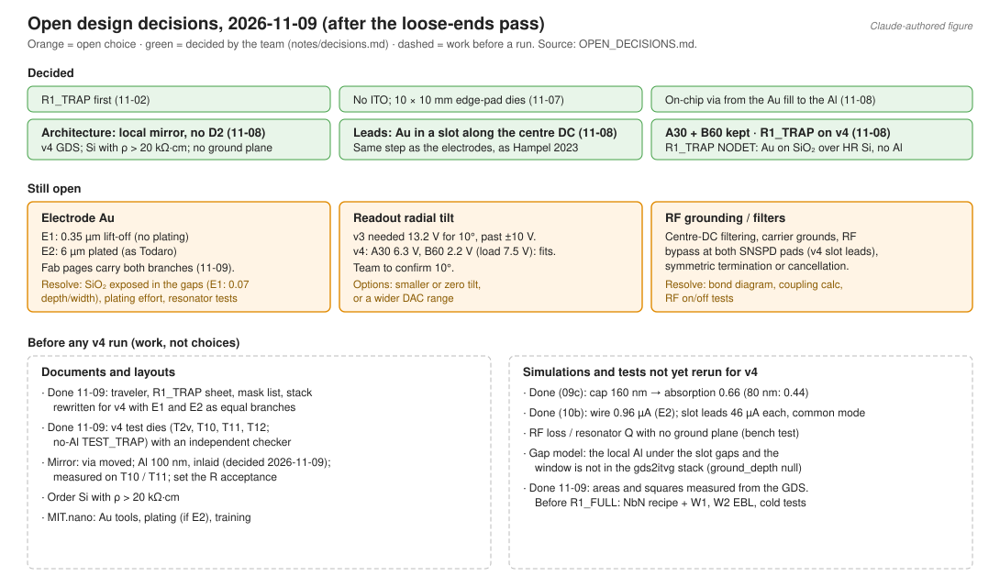

> **Claude-authored.** Reorganized 2026-11-08 from the project fabrication notes.

# Open design decisions and run requirements

[Fab overview](README.md) · [Variants](VARIANTS.md) · [Open decisions](OPEN_DECISIONS.md)

The first section concerns design choices; the next sections prepare each run. An unchecked item does not reverse an adopted choice. Recipe values tagged **[verify]** remain provisional.

## Design choices

The two architectures in cross-section: [architecture comparison](figures/architecture_crosssection.svg) (also in [Local mirror H.0](variants/LOCAL_MIRROR.md#h0-why-the-baseline-has-a-thick-d2-ground-plane-and-mirror-together)).

| Decision | Choices | What resolves it | Status |
| --- | --- | --- | --- |
| Electrode Au (v4) | E1: 0.35 µm lift-off (no plating); E2: 6 µm plated (as Todaro) | As traps they are the same (voltages equal to 0.01 V). They differ in four ways (DESIGN_LOG step 31, `sim/18`): screening of charge on the SiO₂ gap floor (0.80 for E1 against 0.023 for E2 [inference]); SNSPD lead resistance (69 Ω against 4 Ω per lead at room temperature); light and window perturbation (E1 collects 1.18× more; null drop ≤ 0.37 against 1.19 µm); RF heating (17× lower on E2 at equal capacitance; 14.6× at the computed chip capacitance of 2.39 pF for E1 and 2.59 pF for E2, `sim/22`, step 41). Plus plating effort, step coverage and bondability | **Open.** No longer blocks the fab pages: both branches are written out (step 36) |
| Readout radial tilt | Keep 10°, smaller tilt, zero tilt, or wider DAC range | v3 needed 13.2 V (A30) / 15.2 V (B60). **v4 needs 6.3 V (A30) / 2.2 V (B60) for 10°** (loading 7.5 V; 480 µm zones) [team calc, steps 25, 27, 28] | Over-range problem gone on v4; team to confirm 10° |
| RF grounding / filters | Centre-DC filtering, carrier grounds, symmetric detector termination or cancellation; for v4 also an RF bypass at both SNSPD lead pads | v4 slot leads each collect 44.5 µA (E2) / 28.6 µA (E1) of common-mode RF over 2.24 mm (`sim/10c`); only termination asymmetry sends it through the nanowire (step 26). Lumped model (step 33, `sim/19`, upper bound): a plain 50 Ω line with the return lead grounded puts 4.1 µA (E2) / 2.6 µA (E1) through the A30 nanowire, against a switching current of 8–20 µA. A 1 nF bypass cuts it to 0.47 µA but low-passes the pulse at 3.2 MHz; a series L-C trap at 28 MHz gives 0.04 µA (0.23 µA if detuned 5 %); a differential 50 Ω / 50 Ω readout gives 0.20 µA per 5 % mismatch. DC-to-RF coupling (step 42, `sim/23`, 2-D): the centre DC couples to the rails through 0.41 pF (A30, E2); with 1 nF to ground it carries 22 mV of RF and moves the null 10 nm, with 10 nF 2.2 mV and 1.0 nm; left with no RF ground it would carry 6 V (45.5 V on NODET). An outer segment couples through 0.015 pF. Still needed: bond diagram, the filter values, RF-on/off tests | **Open; more important on v4** |
| Pad pitch / beam access | Current generated layout: 360 µm; alternatives recorded for the proposed choice: 180, 240, 300, 400 µm | Centre-to-centre PGA84L fan-out passes (worst 20.03°; step 29), as do all seven sim 12 cases. Closest top/bottom pads are at x = +0.62 / −0.98 mm; confirm clearance for a future perpendicular beam near the zones | **Team adoption pending.** Proposed reason: keep wire angles below 45° for a PGA84L-like package; no additional reason supplied |
| Carrier | PGA84L-like 84-pin package, 100-pin CPGA, or the lab carrier | Cryostat fit and a carrier-specific electrical pin map; step 29 checks nominal PGA84L geometry only | **Open.** Local finger IDs in the fan-out table are not package pin numbers |
| Package spacer | Proposed thickness ≥ approximately 0.6 mm; die-sized (10 × 10 mm) or larger; Si suggested | Verify the actual carrier, die and spacer stack and beam clearance | **Open proposal [verify]**, not an adopted material or thickness |
| ITO cap over the detector (raised in the team notes as a possibility) | No ITO (adopted 2026-11-07, [decisions](../../notes/decisions.md)); ITO cap over the detector | The team reopening the 2026-11-07 decision "No ITO anywhere" ([decisions](../../notes/decisions.md)) | **Possibility, not adopted.** Conflicts with the 2026-11-07 decision "No ITO anywhere"; it stands only if the team reopens that decision |

**One-page briefs** (numbers and sources side by side; no recommendation): [E1 vs E2](briefs/E1_vs_E2.md) · [readout tilt](briefs/readout_tilt.md) · [RF grounding and lead termination](briefs/rf_grounding_and_termination.md) · [pad pitch](briefs/pad_pitch.md) · [carrier and spacer](briefs/carrier_and_spacer.md) · [mirror, raised or inlaid](briefs/mirror_raised_vs_inlaid.md).

**Resolved 2026-11-08** ([decisions](../../notes/decisions.md)): architecture → local mirror, no D2; lead routing → Au leads in a slot along the centre DC; detector allocation → keep A30 and B60 (B60 was dropped, then kept); R1_TRAP → the same no-Al stack.

### Before any v4 run

- [ ] Choose E1 vs E2. The fab pages no longer wait for it.
- [x] Rewrite the traveler, R1_TRAP run sheet, mask list, stack and qualification pages for v4: done 2026-11-09 with E1 and E2 as parallel branches (DESIGN_LOG step 36). When the team chooses, delete the other branch.
- [x] Rework the test dies for v4: done 2026-11-09 (`gds/test_die_v4`, `test_die_v4_TRAP`; step 35). T2 is replaced by T2v; T10, T11 and T12 are new; TEST_TRAP carries T1 and T6 only, with no Al. Both pass `gds/check_test_die.py`.
- [x] **Al mirror: 100 nm, inlaid** (team decision 2026-11-09, [decisions](../../notes/decisions.md); DESIGN_LOG steps 37 and 38). It replaces the 450 nm mirror, which left a 0.45 µm step under the centre DC and the slot leads. `sim/10c`: about 3.2 mA goes along the strip to ground; the extra nanowire current is at most 0.73–0.97 µA (E2); the strip dissipates 34–45 µW; the ion is not affected. Step 3 is now resist, 100 nm SiO₂ recess, Al evaporation, lift-off ([foundation page](process/01_FOUNDATION.md)).
- [ ] **Mirror edge on the centre-DC edge (DESIGN_LOG step 39, `sim/10d`).** With E1, a mirror 2 µm off centre moves the RF null 0.5 µm sideways, and 5 µm off moves it 1.05 µm; with E2 it is 15–30 nm. The step of a raised 100 nm mirror is small by comparison (null 0.13–0.16 µm higher, uniform). Proposal: narrow the mirror to \|y\| ≤ 18 µm (layer 10 of A30 and B60 only; 2 µm beyond the NbN, 2 µm inside the Au), and hold the layer-10 overlay to about 1 µm instead of the ±5 µm on the [mask list](mask_list.md). Not done: it changes the released dies. Optional: the shift is static and the DC electrodes compensate it (about 18 V/m per µm of shift; with no trim the ion still follows the null to within about 4 %), so this only saves a trim (step 39 addendum).
- [ ] **Raised or inlaid:** for the ion the two are equivalent at 100 nm (step 39). The inlay is kept on the pages; the raised mirror is the simpler process and is the named fallback. The team may swap them.
- [ ] **Inlaid mirror, to prove before a device wafer:** witness loop W8 ([qualification](QUALIFICATION.md)): recess depth and RIE rate with the lift-off resist on the wafer; lift-off after the fluorine etch; residual step and edge profile (≤ 20 nm, a design call); hillocks on evaporated Al after 300 °C. No source read so far covers the recess-and-lift-off step (`research/research_notes/Loose ends 2026-11/L3_inlaid_mirror.md`). Fallback: skip the recess (100 nm raised).
- [ ] **Inlaid mirror, facility:** an Al source on the E1 evaporator; the SiO₂ RIE recipe and rate on our tool; over-etch into the 100 nm Al at the mirror via (step 11).
- [ ] **Mirror strip heating:** 34–45 µW in the strip at 53 V, 28 MHz (room-temperature resistivity; no thermal model). In the cold RF test, watch the SNSPD switching current against RF amplitude.
- [x] Mirror ground path: via moved to just past the RF open end (step 28). The Al was 450 nm from 2026-11-08 and is **100 nm, inlaid** from 2026-11-09 (item above): swing 30–40 mV, at most +0.73–0.97 µA on E2 (`sim/10c`, DESIGN_LOG step 37). The strip is measured on test structure T10 (62.75 squares, 18.8–25.1 Ω expected) and the via contact on T11, in place of a probe opening on the trap die. Still to do: set the T10 acceptance limit; check hillocks on a witness wafer (W8).
- [x] 09c optics (step 26): **set the SiO₂ over the wires (HSQ + cap) to 160 ± 10 nm**: A 0.44 → 0.66 (v3.1: 0.54). The pages, `make_chip.py` and the `_sim.json` files now all say 160 nm (step 35).
- [x] 10b RF pickup (step 26): nanowire 0.96 µA (E2) / 1.92 µA (E1) vs 1.67 µA (v3.1); slot-lead pickup feeds the RF grounding decision above.
- [x] Rerun 15 at the v4 heights: done as `sim/15b_collection_v4.py` (step 32). A30 E2 collects 2.22 % and absorbs 1.47 % of all emitted photons with the 160 nm cap; B60 E2 4.16 % and 2.71 %.
- [ ] Transport: hold the centre DC at 0 V while moving and ramp the tilt in at each zone (`12_final_chip_check.py --centre-dc-zero`: **1.708 V per 10 µm step** on A30/B60 with the 480 µm zone spacing and 360 µm pad pitch; free-centre transport 7.590 / 8.002 V, step 29). The constrained static 10° zone solves remain diagnostic; use the regular zone sets once stationary.
- [x] Transport waveform (steps 34 and 40, `sim/20`, `sim/21`): `sim/out/21_transport_waveform/<die>/waveform.csv` holds voltages against time for a 1 ms minimum-jerk move with the tilt ramped out and in, sampled at 1 MHz and quantised to 16 bit. It reproduces the sim 12 table to 5 µV; interpolation puts the well within 0.01 nm of its target (0.29 nm on B60, solved on a 5 µm grid); at 1 MHz updates the classical model leaves under 10⁻³ quanta.
- [ ] Transport hardware: the DAC update rate, resolution and filter corner used in `sim/21` are **[verify]** (lab hardware not known). Avoid an update rate that divides the axial frequency exactly: at 100 kHz and 0.8 MHz the model leaves 5 × 10⁶ quanta whatever the move time (step 40).
- [ ] Order Si with ρ > 20 kΩ·cm; measure the RF resonator Q with a die mounted. Measure it cold: at room temperature about 63 % of the RF field energy is in Si with a loss tangent near 0.27 at 28 MHz, so the warm Q is low and does not predict the cold value (step 41, first-order estimate).
- [ ] New from the page rewrite (step 36), for the team: does R1_TRAP also deposit the 398 nm of PECVD SiO₂ (spacer + cap) so its electrodes sit on the same surface as the detector dies? Do NODET dies on R1_FULL get steps 4–8? Which witness covers the 300 °C cap deposition on NbN now that W1-b is gone?
- [ ] Measure the Au film resistivity at 4 K on a witness (E1 evaporated, E2 plated). No value was found in the literature, and the SNSPD lead resistance on E1 depends on it (step 31).

### Detector documents and generated layouts

> [!note] Reconciled 2026-11-09 against the released files
> [`gds/measured_v4.md`](../gds/measured_v4.md) is written by `gds/measure_dies.py` from the GDS files themselves and records each file's hash. The pages now cite it. Regenerate it after any layout change and before an exposure export; a hash that differs from the table means the numbers are stale.

- [x] Record the generator revision for trap dies, test die and run GDS; verify the generated files match the 130/200 nm rounded-turn geometry. Measured: 160 lines, 0.130 µm wide on a 0.200 µm pitch, 36 µm (A30) / 69 µm (B60) long (step 35).
- [x] Check detector/test-die geometry, contact connectivity and clearances, including T9. `gds/check_test_die.py` passes: 20 NbN pieces, each on its own leads; every meander on its own Al mirror. The run maps use the v4 dies.
- [x] Re-measure the layer areas for both runs: in `gds/measured_v4.md` (Au 5.917 cm² for R1_TRAP, 5.735 cm² for R1_FULL; EBL 0.0496 mm² for R1_FULL). EBL time and charge still depend on the dose from W2.
- [ ] Calibrate the 130/70 nm SEM target on W2. Validate the separate T9 screening criteria in electrical test a14.
- [x] Verify square count, inductance and reset time against the released GDS: straight sections 5.760 / 11.040 mm, 3.10 / 5.94 µH, 62.0 / 118.8 ns (turns, tapers and tabs excluded). The resistance acceptance in a7 still needs the measured sheet resistance.
- [x] `sim/15_snspd_geometry.py` and the GDS both use the 32 µm radial extent (DESIGN_LOG step 24: OVH_Y = 1 µm after the sim/10 v3.1 RF scan).
- [x] Reconcile absorption and RF pickup for the changed fill factor/footprint: absorption in steps 26 and 32 (0.66 with the 160 nm cap), pickup in steps 26, 28 and 33. Switching current itself is still an estimate (8–20 µA) until the cold test.

Sources: [trap generator](../gds/make_chip.py), [test generator](../gds/make_test_die.py), [geometry study](../sim/15_snspd_geometry.py), [geometry audit](../research/reports/SNSPD%20geometry%20audit.md).

## Before R1_TRAP

- [ ] Confirm Au-compatible tools, gold bath/minimum area, holders and training order with MIT.nano.
- [ ] ~~W3: qualify D2 stress/backside compensation and chuck bow limit; calibrate L40 and gap etches.~~ Not needed for v4 (no D2, no gap etch). The L40 cap + spacer etch (≈ 0.40 µm, stopping on the 100 nm Al) still needs a short calibration before R1_FULL.
- [ ] Before R1_FULL (v4 A30/B60): compare Au-to-Al contact at the mirror via with/without Ar pre-clean; confirm the AJA substrate RF etch. R1_TRAP has no Al.
- [ ] W5 (only if E2): calibrate plating current on the R1_TRAP pattern; check thickness, gaps and bondability. If E1: lift-off of 0.35 µm Au over 5 µm gaps and wedge bonding on evaporated Au instead.
- [ ] W7: bond-and-leak loop; confirm bonder/wedge dimensions and carrier bond diagram.
- [ ] Verify mark coordinates, polarity and die IDs against [layout](LAYOUT.md) and [exposure checklist](mask_list.md#4-export-checklist-per-job).

See [Qualification](QUALIFICATION.md). No completed witness-wafer measurements are recorded in the reviewed progress notes.

## Before R1_FULL

- [ ] Finish detector reconciliation above.
- [ ] Obtain the full NbN recipe and sputter access; W1-a/b qualify the real stack and thermal history.
- [ ] W2: set HSQ dose/development/etch on the actual EBL tool; confirm mark recognition and L22-to-L50 overlay.
- [ ] Confirm test-die detector pads can be bonded for cold tests.
- [ ] Measure switching current and count plateau at operating temperature with RF off/on. The geometry audit questions the earlier 15–25 µA estimate; cold-test acceptance remains provisional.
- [ ] Compare charging drift and click-induced heating over bare SiO₂ with NODET.

## Source and model checks

- [x] Resolve “Dietl 2025”: M. Dietl et al., "Test and characterization of multilayer ion traps on fused silica", arXiv:2505.21284 ([literature note](../research/research_notes/Loose%20ends%202026-11/L2_open_sources.md)). Its Table 2 gives the 50 V DC / 300 V RF, 0–100 nA leakage limits and the 1 mA, 0–100 mV continuity test. Those traps have Al electrodes on fused silica. No comb structure or flashover measurement was found in it, so the T1 limits stay **[verify]**. The paper was read through a summarising tool: check the table against the PDF.
- [ ] Ba⁺ angular-emission model, partly resolved: the π and σ patterns of a J = 1/2 upper level sum to 1/(4π) (algebra, [team calc]), and Auzinsh, Budker and Rochester (arXiv:0908.2666, Sec. II.4) state that fluorescence shows excited-state polarization of rank at most 2J_e, so J_e = 1/2 carries no alignment ([literature note](../research/research_notes/Loose%20ends%202026-11/L1_ba_emission_and_detection.md)). No textbook passage stating the isotropy outright was opened. The polarisation is not isotropic, and the meander absorbs the two polarisations differently.
- [ ] Suleimen 2026 is Phys. Rev. Applied 25, 044091; only the abstract is open. Read the full text before using its width comparison (T9).
- [x] RCWA of the meander at normal incidence (step 43, `sim/24`): 0.83 unpolarised with the 160 nm cap, against 0.66 from the effective-medium model; the difference is in the polarisation across the wires. The key-number tables still quote the effective-medium value.
- [ ] Still open: RCWA averaged over the ion's emission cone (or FDTD); the 3-D pickup on the SNSPD leads (step 42 says why the planned method was not attempted); a second RCWA code as a cross-check.
- [x] Chip RF capacitance (step 41, `sim/22`): 2.59 pF (A30, E2), 2.39 pF (A30, E1), from 2-D sections of the RF net; 24.2 / 22.3 mA at 53 V, 28 MHz.
- [ ] Not measured: the loss tangent of the PECVD and thermal SiO₂ (sets the cold Q of the chip, step 41).
- [x] ~~Reconcile the full-stack physical Al-to-Au separation (~10.3 µm) with the model's 10.0 µm ground-depth parameter.~~ v3 only: v4 has no ground plane (`ground_depth: null`).

## Choices already recorded as the team's

Project scope and fixed inputs, separate loading zone, high-resistivity Si, 50 µm height and the height policy, no bowtie, the narrow die (superseded), NODET die, R&D runs at MIT.nano, R1_TRAP first (all 2026-11-02, backfilled); no ITO and 10 × 10 mm edge-pad dies (2026-11-07); on-chip Au-fill-to-Al via (2026-11-08); local-mirror architecture, slot leads, A30 only then A30 + B60 retained, R1_TRAP on the v4 stack (2026-11-08). All are logged in [`notes/decisions.md`](../../notes/decisions.md), which Claude now writes for the team. Current layout uses 480 µm zone spacing and 0.8 MHz axial confinement. The generated 360 µm pad pitch remains pending team adoption (step 29).

The 50 µm height was checked again on 2026-11-09 (DESIGN_LOG step 30, `sim/17`): going to 40 µm with the same window gives 1.44× the light for 2.4× the heating and 2.6× the clipped beam power, and the same gain is available at 50 µm from the 160 nm cap, B60, E1 or a wider centre DC. The team adopted this as its reason for keeping 50 µm on 2026-11-09 ([decisions](../../notes/decisions.md)).
