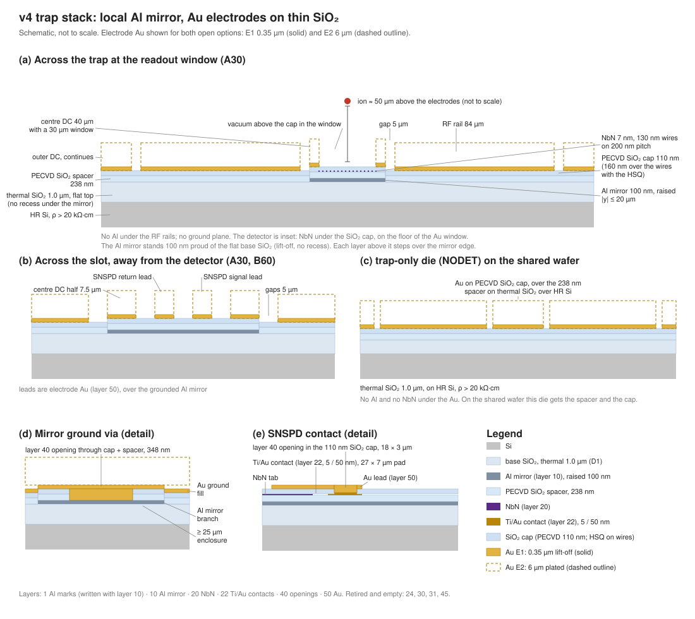

> **Claude-authored.** Rewritten for v4 2026-11-09; mirror 100 nm 2026-11-09; final stack 2026-11-12.

# Layer stack and thermal budget

[Fab overview](README.md) · [Variants](VARIANTS.md) · [Open decisions](OPEN_DECISIONS.md)

> [!note] Electrode Au: both options shown
> E1 = Ti 10 nm / Au 350 nm lift-off. E2 = 6 µm plated Au. The team has not chosen between them ([open decisions](OPEN_DECISIONS.md)). Rows that depend on the choice say so. The rest of this page is the final v4 stack of 2026-11-12.

> [!note] Scope
> v4 local-mirror architecture ([LOCAL_MIRROR.md](variants/LOCAL_MIRROR.md) H.1–H.4; team decisions in [decisions](../../notes/decisions.md); DESIGN_LOG steps 25–28, 37, 39, 45). Final stack adopted 2026-11-12 for the one-wafer run R1_ONE: one wafer carries all four chips (A30, B60, SNSPD-only, NODET). A30 and B60 dies carry the full detector stack. The NODET (trap-only) die carries the spacer and the cap, but no NbN under its electrodes and no Al except the four corner marks. The [R1_TRAP sheet](RUNSHEET_R1_TRAP.md) is superseded for R1_ONE. Optical values are TMM with effective medium, not RCWA. A new RCWA scan is still running; its value will be added to this page.

## Readout cross section

The Al mirror is raised. It is 100 nm of evaporated Al standing on the base SiO₂ (step 3, lift-off; the earlier inlaid recess is superseded, team decision 2026-11-09 and the 2026-11-12 pass, [decisions](../../notes/decisions.md)). So the spacer, NbN, cap and electrode Au all step up 100 nm over each mirror edge. The 100 nm step lifts the RF null by 0.13–0.16 µm, the same for raised and inlaid (`design/sim/out/10d_mirror_step/table.md`, DESIGN_LOG step 39). Witness loop W8 tests the raised mirror before any run (see [QUALIFICATION.md](QUALIFICATION.md)).

Stack under the readout window, listed bottom to top. Values are final v4 (DESIGN_LOG steps 25, 26, 28, 45; LOCAL_MIRROR H.3).

| Layer | Thickness | Role / note |
|---|---|---|
| HR FZ Si | ~525 µm [verify]; ρ > 20 kΩ·cm (was > 10⁴ Ω·cm) | RF substrate with no ground plane. This Si is what the local-mirror design needs (NIST practice; LOCAL_MIRROR H.4). Thickness as supplied [verify on the wafer box] |
| Base SiO₂ | 1.0 µm nominal; 0.5–2.0 µm accepted as supplied (table below) | Isolation under the mirror and electrodes. Under the mirror it is 1.0 µm: there is no recess. Source of the base: [01 foundation](process/01_FOUNDATION.md), step 2 |
| Al mirror and alignment marks (layers 10 and 1, one exposure), raised | 100 ± 10 nm evaporated Al, lift-off | Local mirror under the SNSPD and its leads only. Opaque (≥ 100 nm). Not under the RF rails. The marks are in the same Al and the same exposure. No recess etch. Numbers: [`sim/10c`](../sim/10c_mirror_thickness.py), DESIGN_LOG step 37 |
| PECVD SiO₂ spacer | 238 ± 10 nm | Second-order cavity spacer for 493 nm. 64 nm (first order) is optically equal (DESIGN_LOG step 26) but sits closer to Al hillocks. **Avoid ≈ 148 nm** (absorption node) |
| NbN meander (L20) | 7.0 ± 0.5 nm; 130 / 200 nm line / pitch; 160 lines | Lines 36 µm (A30) / 69 µm (B60) long, with end blocks and tabs under Au (`gds/snspd_geom.py`, step 24) |
| Ti/Au contacts (L22) | Ti 5 nm / Au 50 nm (was 10 / 350 nm) [verify] | NbN tabs to the slot contact pads; EBL marks. Contacts only: no buried leads. See the section below |
| HSQ (wires only) | 50 nm after develop (target; measured) | Left on the NbN wires only (layer 20). Not on the contact pads or in the slot |
| PECVD SiO₂ cap | 110 nm, blanket | Cap = 160 nm − HSQ left. Over the wires SiO₂ totals 160 ± 10 nm (HSQ + cap). Elsewhere the cap is 110 nm |
| Au window walls and electrodes (L50) | E1: 0.35 µm; E2: 6 µm | Window is a 30 × 30 µm hole (A30) or 60 × 30 µm (B60) in the electrode Au. Both options shown; choice open |
| Vacuum; ion | Ion planar height 49.98 µm at readout. Over the window: A30 −1.19 µm (E2), ≤ −0.37 µm (E1); B60 −2.04 µm (E2), ≤ −0.55 µm (E1) | Recess from the grounded floor (steps 25, 26). This recess is the RF null, not the mirror recess |

Derived (team calc):
- SiO₂ between the electrode Au and the Si, off the mirror: 1.0 + 0.238 + 0.110 = 1.348 µm, about 1.35 µm. The old "~1.3 µm" and "about 1.4 µm" are superseded.
- SiO₂ between the Au and the Al, off the wires: 238 + 110 = 348 nm. The old "398 nm" and "0.40 µm" are superseded.
- Window floor (top of the cap over the wires): 238 + 7 + 160 = 405 nm above the mirror. The old "0.40 µm" is superseded.

### Base SiO₂ thickness (sim 22b)

Source: `design/sim/out/22b_base_sio2_sweep/table.md`. A30 chip, final stack.

| Base SiO₂ | C_chip cold (Si lossless), E2 / E1 | C_chip with the Si as a grounded conductor (room-temperature limit), E2 / E1 |
|---|---|---|
| 0.15 µm | 2.878 / 2.682 pF | 57.5 / 57.3 pF |
| 0.30 µm | 2.813 / 2.617 pF | 45.1 / 44.9 pF |
| 0.50 µm | 2.738 / 2.542 pF | 35.1 / 34.9 pF |
| 1.00 µm | 2.589 / 2.394 pF | 22.8 / 22.6 pF |
| 2.00 µm | 2.383 / 2.188 pF | 13.6 / 13.4 pF |

Reading:
- Cold, the chip capacitance moves only from 2.88 to 2.38 pF (E2) across 0.15–2.0 µm. The base SiO₂ thickness is not critical for cold operation.
- Warm, the capacitance to the conducting Si goes roughly as 1 / thickness. A thin base SiO₂ makes any room-temperature RF measurement worse.

The chip capacitance quoted elsewhere stays 2.59 pF (E2) / 2.39 pF (E1) at 1.0 µm.

If the wafers arrive bare, the base comes from thermal oxidation or from a PECVD SiO₂ base. Hampel 2023 used 150 nm PECVD SiO₂ and Todaro 2021 used 134 nm (both cited as examples, not our recipe). [verify which the team does]

### Why the Ti/Au contact layer exists and why it is thin

- It is put on the NbN before the SiO₂ cap as the etch stop for the opening etch. The fluorine plasma that opens SiO₂ also etches NbN, and 7 nm cannot stop it.
- It carries the e-beam alignment crosses, which must exist before the nanowire is written.
- About 20 µm of each contact strip lies under the centre-DC Au with only the 110 nm cap between, so it must be thin. 350 nm was the v3 lead thickness and has no job in v4.
- [verify] e-beam mark contrast on 50 nm Au, and the Au lost in the opening over-etch.

### What the 100 nm mirror costs

All values are from `sim/10c_mirror_thickness.py`: case `al100_cap110` (slot cross-section of the final stack, 110 nm cap under the leads) for the mirror and the leads; case `al100` (raised 100 nm Al, 160 nm over the wires) for the direct nanowire pickup. 53 V, 28 MHz, 2-D model, upper bounds, room-temperature Al resistivity (3–4 µΩ·cm), no thermal model. DESIGN_LOG steps 37 and 45.

| Quantity | E2 (6 µm Au) | E1 (0.35 µm Au) | case |
|---|---|---|---|
| Direct RF pickup in the nanowire | 0.96 µA | 1.92 µA | al100 |
| RF current along the mirror strip to ground | 3.1 mA | 3.2 mA | al100_cap110 |
| Mirror swing at the detector end | 29.7–39.6 mV | 30.3–40.4 mV | al100_cap110 |
| Extra nanowire current from the mirror path, upper bound | 0.72–0.96 µA | 0.73–0.97 µA | al100_cap110 |
| Dissipation in the Al strip | 32.9–43.9 µW | 34.2–45.6 µW | al100_cap110 |
| Common-mode RF current per slot lead (direct) | 44.5 µA | 28.4 µA | al100_cap110 |
| Current the mirror swing adds to each lead | 4.5–6.1 µA | 4.6–6.1 µA | al100_cap110 |
| Lead-to-mirror capacitance | 0.551 fF/µm | 0.544 fF/µm | al100_cap110 |
| Mirror strip resistance (62.75 squares) | 18.8–25.1 Ω | same | either |
| Micromotion from the mirror swing through the window, A30 / B60 | 1.5–2.1 nm / 3.1–4.1 nm | 1.6–2.1 nm / 3.1–4.2 nm | al100_cap110 |

- The strip current goes to ground, not into the SNSPD.
- The switching current of the nanowire is 8–20 µA (for comparison with the extra nanowire current).
- The strip dissipation is the main cost of the thin mirror. The 450 nm mirror dissipated 7–10 µW.

**Optics (v4, DESIGN_LOG step 26, `09c`).** Absorption in NbN at 493 nm ≈ 0.66 with a 159–160 nm cap (±10 nm box mean 0.645; worst corner 0.596). The earlier 80 nm cap gives 0.44. `make_chip.py` and the simulation metadata state 160 nm (corrected 2026-11-09; geometry unchanged); 160 nm is the deposition target over the wires (HSQ 50 nm + cap 110 nm). The model reads ~10 % pessimistic against Hampel. These are TMM effective-medium numbers, not RCWA. `09b` (vacuum above the cap) is superseded by `09c` for v4.

### (a) Readout window, top to bottom (A30; B60 has a 60 × 30 µm opening)

1. Vacuum; ion at 49.98 µm planar, lowered over the window by the recess in the table above.
2. HSQ (50 nm, wires) + PECVD SiO₂ cap; SiO₂ over the wires 160 ± 10 nm. Its top surface is the window floor, 405 nm above the mirror.
3. NbN meander, 7 nm.
4. PECVD SiO₂ spacer, 238 nm.
5. Al mirror, 100 nm, raised on the base SiO₂, under the window, grounded through the mirror via and the Au ground fill.
6. Base SiO₂, 1.0 µm, under the mirror (no recess).
7. HR Si, ρ > 20 kΩ·cm.

Beside the window the Au walls (L50) sit on the cap: 0.35 µm (E1) or 6 µm (E2) deep.

### (b) Slot region with the Au SNSPD leads over the mirror, top to bottom

The slot is |y| < 12.5 µm, x < 175 µm (A30). Two 5 µm leads sit at |y| = 5 µm. The mirror lies under the whole slot.

1. Vacuum.
2. Au SNSPD lead (part of L50): E1 Ti 10 nm / Au 350 nm lift-off, or E2 6 µm plated Au on the L50 seed.
3. PECVD SiO₂ cap, 110 nm (no HSQ in the slot). The cap is opened (L40) only at the contact pad: the lead reaches the L22 Ti/Au pad (27 × 7 µm, x = 143 … 170 µm), which is the contact to the NbN tab.
4. PECVD SiO₂ spacer, 238 nm.
5. Al mirror, 100 nm, raised on the base SiO₂, grounded through the mirror via at (−2140, 130) µm.
6. Base SiO₂, 1.0 µm.
7. HR Si.

No Au or Ti is buried under the centre DC; the leads are the only Au in the slot.

### (c) NODET die (R1_ONE), top to bottom

1. Vacuum.
2. Au electrodes (L50): E1 Ti 10 nm / Au 350 nm lift-off, or E2 Ti 15 nm / Au 50 nm seed with 6 µm plated Au (steps 12–15 as written).
3. PECVD SiO₂ cap, 110 nm (blanket).
4. PECVD SiO₂ spacer, 238 nm (blanket).
5. Base SiO₂, 1.0 µm.
6. HR Si, ρ > 20 kΩ·cm.

No Al under the electrodes (the four corner marks are Al, outside the trap). No NbN under the electrodes: the blanket NbN is etched off in step 7 [verify the etch that clears it over the whole die]. The Au sits on the same surface as A30 (base SiO₂, spacer, cap), so the trap-only die sees the same surface as the detector dies. [team calc from the R1_ONE run layout]

### (d) Elsewhere on A30 and B60 (RF rails, outer DC segments)

Top to bottom: vacuum; Au electrodes (E1 or E2); PECVD SiO₂ spacer (238 nm) and cap (110 nm); base SiO₂ (1.0 µm); HR Si. No Al below. The spacer and cap are exposed in the gaps (LOCAL_MIRROR H.4).

## Layer table (final v4, 2026-11-12)

| GDS layer | Name | Material | Thickness | How patterned | Purpose |
|---|---|---|---|---|---|
| 1 | MARK | Al | 100 nm | Drawn in the same exposure and lift-off as layer 10 (step 3). No Si etch | Alignment marks |
| – | D1 (base) | Thermal SiO₂ or PECVD SiO₂ [verify which] | 1.0 µm nominal (0.5–2.0 µm accepted) | Oxidation or deposition, blanket (step 2); skipped if the wafers arrive with it | Isolation under the mirror and electrodes |
| 10 | M1 | Evaporated Al | 100 nm | Drawn (not inverted): resist, Al evaporation, lift-off (step 3). Raised; no recess etch | SNSPD mirror and its ground; grounded to the Au fill through the mirror via |
| – | Spacer | PECVD SiO₂ | 238 ± 10 nm | Blanket (step 4) | Cavity spacer for 493 nm |
| 20 | NbN | NbN | 7.0 ± 0.5 nm | Blanket sputter (step 5); meander by EBL and CF₄ etch (step 7) | Detector |
| 22 | Ti/Au | Ti/Au | Ti 5 nm / Au 50 nm [verify] | Lift-off (step 6) | NbN tab to slot contact pads; EBL marks. Not leads |
| – | Cap | HSQ on wires (50 nm) + PECVD SiO₂ (110 nm) | 160 ± 10 nm over the wires; 110 nm elsewhere | HSQ by EBL (step 7); PECVD blanket (step 8) | Optical matching layer; window floor |
| 40 | Openings | SiO₂ (cap and spacer) | 110 nm (SNSPD contacts, to the layer-22 Au); 348 nm (mirror via, cap + spacer, to the Al) | One etch: thin positive resist ≈ 1.3 µm; CHF₃ / CF₄ / Ar (step 11) [verify the over-etch on the 50 nm Au] | SNSPD contact and mirror ground openings |
| 50 | Electrodes | Au; Ti adhesion (E1 Ti 10 nm; E2 Ti 15 nm / Au 50 nm seed) | E1: 0.35 µm Au [verify thickness]; E2: 6 µm plated Au | E1: LOR + positive resist, MLA150, lift-off in NMP, in-situ Ar pre-clean before Ti (steps 12v–15v). E2: steps 12–15 as written [verify seed on the thin stack] | RF and DC electrodes, ground fill, SNSPD leads in the slot, window walls |
| 100, 101 | Notes, outlines | – | – | – | Not fabricated |

Five lithography layers on R1_ONE: Al and marks (10, with 1), Ti/Au (22), NbN (20), openings (40), Au (50). The former six are down to five: the Si mark etch is gone. [team calc]

Alignment: step 3 (first layer, Al + marks) aligns to the wafer flat. Layers 22, 40 and 50 align to the Al marks, seen through the SiO₂ [verify on the MLA150]. The e-beam aligns layer 20 to the layer-22 Au crosses.

## Thermal budget

| Step | Max T | Time at T | Note |
|---|---|---|---|
| 2 Base SiO₂ (thermal) | ~1000–1100 °C [verify furnace recipe]; or PECVD ≤ 300 °C | hours | Before Al and NbN, so no limit applies |
| 3 Al evaporation (100 nm), no etch before it | Not quantified [verify] | min | Evaporation heating not quantified [verify] |
| 4 Spacer PECVD | ≤ 300 °C | ~5 min | First anneal of the Al. Check the Al for hillocks after this step (darkfield) |
| 5 NbN sputter | ~RT (unheated; plasma heating unquantified) | min | Dane 2017 recipe is unheated |
| 6, 7, 11, 13 resist bakes | ≤ 115 °C (HSQ bake per datasheet [verify]) | min | – |
| 8 Cap PECVD (110 nm blanket) | ≤ 300 °C | min | – |
| 9, 10 | Skipped in v4 (10 µm D2 removed) | – | No long 300 °C exposure |
| 14 Plating bath (E2 only) | ~50–65 °C [verify bath datasheet] | ~30–60 min | No plating step on E1 |
| 19 Die attach / bake-out | ≤ 150–200 °C [verify adhesive] | hours–days | Au–Al intermetallics on bakes [inference] |

| Limit | Value | Source |
|---|---|---|
| Al hillocks / voids | significant at ~350 °C; Al-1%Cu or a Ti/TiW cap suppresses them | SINTEF; JoVE M1 step ("prevent whisker formation during bakeout") |
| Al hillocks, mirror is evaporated Al | Hampel 2023: 50 nm e-beam evaporated Al under SiO₂ went through co-sputtered NbTiN at 500 °C (a 50 nm film, not the 100 nm mirror). Hillocks after the ≤ 300 °C steps must be checked on witness loop W8 ([QUALIFICATION.md](QUALIFICATION.md)) | Hampel 2023 (arXiv:2302.01462); team check on W8 |
| **Rule for this run** | **≤ 300 °C for every step after step 3**. On R1_ONE this applies to every die, because all dies carry the Al marks from step 3 | team inference from the two lines above |
| NbN, inert ambient | Tc stable to 500 °C | arXiv:2501.07780 |
| NbN, uncapped in O₂ | Tc drops | Ioffe paper (research report) |
| NbN in air | Nb₂O₅ grows as d_ox = 0.78 t^0.17 nm (t in days): ~0.8 nm after 1 day | Medeiros 2019 |

## Changed 2026-11-12 (final stack, this pass)

- **Mirror raised.** 100 nm evaporated Al stands on the base SiO₂ (lift-off, no recess etch). The inlaid version of 2026-11-09 is superseded. The layers step 100 nm over each mirror edge (sim 10d: 0.13–0.16 µm null lift).
- **Marks in Al.** Layer 1 alignment marks are written in Al with layer 10 (one exposure, one lift-off). The Si-etched marks (old step 1) are removed.
- **Contacts thin.** Layer 22 is Ti 5 nm / Au 50 nm (was 10 / 350 nm).
- **Cap defined as one blanket number.** The PECVD SiO₂ cap is 110 nm blanket. With HSQ 50 nm on the wires, SiO₂ over the wires is 160 ± 10 nm. The openings are 110 nm (contacts) and 348 nm (mirror via).
- **Base SiO₂.** 1.0 µm nominal, accepted 0.5–2.0 µm as supplied (sim 22b, the table above). The backside stress-balance sentence and the recess sentence are removed.
- **One wafer for all dies.** R1_ONE: the trap-only (NODET) die gets the spacer, the NbN (etched off in step 7) and the cap. Derived: SiO₂ to the Si off the mirror 1.348 µm; Au to Al off the wires 348 nm; window floor 405 nm above the mirror.
- Optics numbers on this page are unchanged. The RCWA value will be added when the scan is done.

## Changed from v3

- Substrate: ρ > 10⁴ Ω·cm → ρ > 20 kΩ·cm.
- Layer 10: die-wide inverted Al plane → local mirror, |y| ≤ 20 µm, x = −2240 … +268 µm (A30); 150 nm (v3) → 450 nm (2026-11-08) → 100 nm, inlaid (2026-11-09) → 100 nm, raised (2026-11-12).
- RF ground plane removed: no Al under the RF rails.
- 10 µm PECVD SiO₂ (D2) removed, with its gap etch and its thermal load (≤ 300 °C, 1–2 h). Layer 45 (protect) removed.
- Cap: 80 ± 10 nm → 160 ± 10 nm total over the wires (2026-11-09); now 110 nm blanket with 50 nm HSQ (2026-11-12).
- Window floor: bare SiO₂ at the top of the 10 µm D2 (6 µm pocket) → the cap, 0.405 µm above the mirror.
- Electrodes: 6 µm plated Au only → E1 0.35 µm lift-off or E2 6 µm plated (open).
- SNSPD leads: buried Ti/Au under the centre DC (L22) → Au leads in the slot (L50). L22 is contacts only.
- L40 openings: through about 10.3 µm of D2 → through the cap and spacer only (SNSPD contacts 110 nm; mirror via 348 nm).
- Mirror ground via: moved to (−2140, 130) µm, just past the RF open end (was (−2450, 130) µm).
- L10 cut-outs under the SNSPD pads and at the mark sites removed (no Al there).
- Window recess: −1.38 µm (A30, v3) → −1.19 µm (A30, E2) or ≤ −0.37 µm (E1).
- Absorption in NbN: ≈ 0.40 (v3, with D2 and no ITO) → ≈ 0.66 (v4, 160 nm cap; DESIGN_LOG step 26).
- Mirror-to-ground resistance: the < 10 Ω test → T10 strip four-point, 18.8–25.1 Ω expected at 100 nm (`sim/10c`, DESIGN_LOG step 37) [team calc]; acceptance limit [verify]. Superseded estimate: about 5 Ω at 450 nm [team calc]. At 150 nm the path was ≈ 14–18 Ω (DESIGN_LOG step 25 [team calc]).
- Hillock check: now also after the spacer deposition (step 4). The mirror is evaporated Al, so W8 also checks hillocks after a 300 °C cycle.
- Thermal: plating runs only on E2.
- ITO (layers 30, 31) and the M1 via (layer 24) remain removed.
