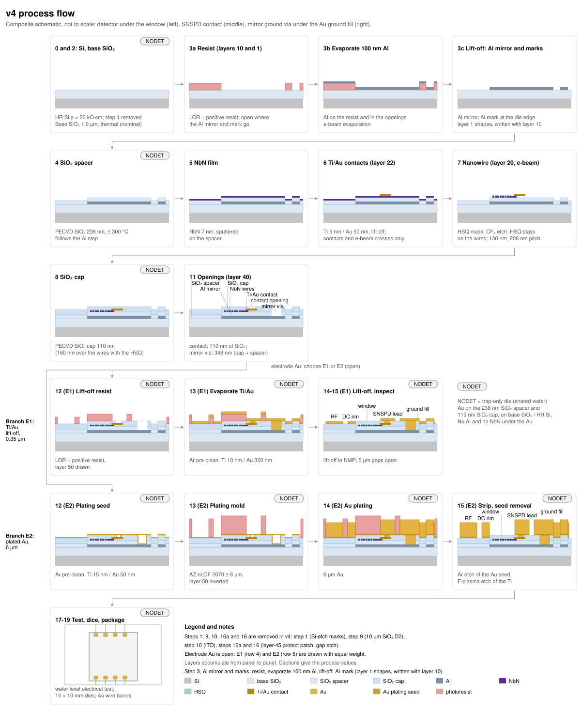

> **Claude-authored.** Reorganized 2026-11-08 from the project fabrication notes. Rewritten for v4 2026-11-09; mirror 100 nm 2026-11-09; final stack and run R1_ONE 2026-11-12.

# Fabrication traveler

[Fab overview](README.md) · [Variants](VARIANTS.md) · [Open decisions](OPEN_DECISIONS.md)

> [!note] v4 index; run R1_ONE; electrode Au still open
> This page indexes steps 0–19 of the adopted v4 local-mirror process ([decisions](../../notes/decisions.md); [local mirror](variants/LOCAL_MIRROR.md)). The run is **R1_ONE** (one wafer, four chip types; team decision 2026-11-12). The team has not chosen the electrode Au: **E1** (Ti 10 nm / Au 350 nm, lift-off) or **E2** (6 µm plated Au). Steps 12–15 are written for both branches. Do not fabricate a branch until the choice is recorded ([open decisions](OPEN_DECISIONS.md)).

Step recipes are on four process pages: [01 foundation](process/01_FOUNDATION.md) (steps 0–3), [02 detector](process/02_DETECTOR.md) (4–8), [03 electrodes](process/03_ELECTRODES.md) (9–16) and [04 packaging](process/04_PACKAGING.md) (17–19). The [R1_TRAP sheet](RUNSHEET_R1_TRAP.md) is superseded for R1_ONE; it now describes only the optional trap-only backup wafer.

The v3 baseline (die-wide Al plane, 10 µm D2) is superseded. Its GDS is archived in [gds/archive_v3_baseline/](../gds/archive_v3_baseline/) and is not for fabrication.

Wafer ID: ________ Run: R1_ONE ________ Generator revision/date: ________ Start date: ________ Operator: ________

> [!important] Before starting
> Complete [qualification](QUALIFICATION.md) and review [open decisions](OPEN_DECISIONS.md). Current generators use v3.1 detectors; older estimates are marked in the detailed notes. This is a proposed process, not a qualified recipe.

## A. Die layout and run (2026-11-12)

- **Run R1_ONE**, one 100 mm wafer, 3 × 3 block of 10 × 10 mm dies at the wafer centre, 200 µm streets, saw cuts at x and y = −15300, −5100, +5100, +15300 µm (10.2 mm pitch both ways), 9 dies. Columns, bottom to top: left A30, SNSPD, A30; middle NODET, A30, NODET; right A30, SNSPD, B60. Die map: [run_R1_ONE_map.csv](../gds/run_R1_ONE_map.csv).
- Die types: **A30** (SNSPD + trap, the detector die; 4 on the wafer), **B60** (1, a spare), **SNSPD-only** (`snspd_die_v4`, new; 2), **NODET** (trap-only; 2). The 2026-11-09 test dies (`test_die_v4`) are not on R1_ONE.
- Trap dies: `gds/trap_die_v4_A30`, `_B60` and `_NODET`. Layout and checks: [LAYOUT](LAYOUT.md) (2026-11-09) and the [measured table](../gds/measured_v4.md) (to be updated for R1_ONE).
- [Layout, marks, pads and protections](LAYOUT.md), rewritten for v4 on 2026-11-09. Areas and counts: [measured table](../gds/measured_v4.md).

### A.1 Resolved in the GDS (v2, carried into v3)

[Layout protections A1–A7](LAYOUT.md#a1-resolved-in-the-gds-v2-carried-into-v3).

### A.2 Still open

[Design decisions and run requirements](OPEN_DECISIONS.md).

### A.3 R&D run plan at MIT.nano

[Run sequence and maps](RUN_PLAN.md).

## B. One-screen process summary

The figure is written by `figures/make_process_flow.py`. It is a composite schematic, not to scale.

Step 3 is now one step: the Al mirror and the marks are drawn in one resist exposure, the 100 nm Al is evaporated, and the lift-off leaves the mirror raised on the base SiO₂. There is no recess. Decision: team decision 2026-11-09 for the inlaid version and 2026-11-12 for the raised one ([decisions](../../notes/decisions.md)). Numbers: `sim/10c` (DESIGN_LOG steps 37, 45) and `sim/10d` (step 39).

"Used in" lists the dies on R1_ONE that receive each step. Every die gets the blanket steps.

| # | Step | GDS layer | Material | Target thickness | Tool (MIT.nano name where verified in the report) | Used in (R1_ONE) |
|---|---|---|---|---|---|---|
| 0 | Wafer prep, clean | – | HR FZ Si, 100 mm, ρ > 20 kΩ·cm | 500–525 µm [verify] | Acid-Etch-General-* (piranha) | all dies |
| 1 | *removed 2026-11-12* (was the Si-etched marks) | – | – | – | – | – |
| 2 | Base SiO₂ | – | SiO₂ (thermal or PECVD) [verify which] | 1.0 µm nominal; 0.5–2.0 µm accepted; skipped if the wafers arrive with it | Ox-Tube-Lindberg / Tube-OxAnneal-Expertech-CTR200 | all dies |
| 3 | Al mirror and alignment marks, raised | 10 and 1 | evaporated Al, on the base SiO₂ | 100 ± 10 nm (was 100 nm inlaid, 450 nm, 150 nm in v3) | MLA150; EBeam-Temescal-FC2800; lift-off | A30, B60 and SNSPD-only: mirror and marks. NODET: four corner marks only |
| 4 | SiO₂ spacer | – | PECVD SiO₂ | 238 ± 10 nm | PECVD-Samco-PD220 or PECVD-Oxford-TEOS | all dies (blanket) |
| 5 | NbN film | – | NbN | 7.0 ± 0.5 nm | Berggren-group AJA (RF substrate bias) [verify access] | all dies (blanket) |
| 6 | Ti/Au NbN contacts and EBL marks (lift-off) | 22 | Ti/Au | **Ti 5 nm / Au 50 nm** [verify] (was 10 / 350 nm) | MLA150; EBeam-Temescal-FC2800 | drawn dies only (A30, B60, SNSPD-only); NODET [verify] |
| 7 | Nanowire EBL + CF₄ etch; HSQ left on the wires | 20 | HSQ on NbN | **HSQ 50 nm after develop** (target, measured) | EBL-Elionix-HS50; RIE-PlasmaTherm-210RL | A30, B60, SNSPD-only (wires). NODET: blanket NbN etched off [verify] |
| 8 | SiO₂ cap | – | PECVD SiO₂ | **110 nm blanket**; SiO₂ over the wires 160 ± 10 nm (HSQ + cap) | PECVD (as step 4) | all dies (blanket) |
| 9 | *removed in v4* (was the 10 µm SiO₂ D2) | – | – | – | – | – |
| 10 | *removed in v4* (was the top ITO) | – | – | – | – | – |
| 11 | Openings through the thin stack | 40 | – | **Contacts 110 nm** (to the Au pad); **mirror via 348 nm** (cap + spacer, to the Al). One etch | MLA150; RIE-F-Samco-230iP / RIE-PlasmaTherm-210RL | A30, B60, SNSPD-only; NODET none [inference] |
| 12 | Electrode Au, step 12: E1 LOR + positive resist; E2 Ti/Au seed | 50 | E1 resist; E2 Ti 15 nm / Au 50 nm seed | – | MLA150; Sputter-AJA-* (E2 seed) | all dies (E1 or E2) |
| 13 | Electrode Au, step 13: E1 Ti 10 nm / Au 350 nm evaporation; E2 nLOF mold ≥ 8 µm, inverted | 50 | E1 Ti/Au; E2 AZ nLOF 2070 | E1 Au 0.35 µm [verify]; E2 mold ≥ 8 µm | E1 evaporator [verify]; E2 MLA150 | all dies (E1 or E2) |
| 14 | Electrode Au, step 14: E1 lift-off in NMP; E2 Au plating | 50 | Au | E1 0.35 µm; E2 6.0 µm | E1 NMP [verify]; E2 Plating-U04 [chemistry unverified] | all dies (E1 or E2) |
| 15 | Inspection (both branches); E2 also strip and seed removal | – | E2: Au 50 nm and Ti 15 nm seed removed | – | E2: Asher-*, Clean-Ar-Plasma [verify it can mill], RIE-F | all dies (E1 or E2) |
| 16a, 16 | *removed in v4* (were the layer-45 protect and the D2 gap etch) | – | – | – | – | – |
| 17 | Room-temperature wafer-level electrical test | – | – | – | ProbeStation-Summit-11000 | all dies |
| 18 | Protect, dice | 101 | – | 10 × 10 mm dies, 200 µm streets; saw cuts at ±5100, ±15300 µm | Diesaw-DAD3240 | all dies |
| 19 | Package, wire bond | – | Au wire on Au pads | – | Wirebond-Wedge / Wirebond-Ball-MEI; carrier open | all dies |

**Which dies get which steps on R1_ONE.** The blanket films (steps 4, 5 and 8) go on every die, including NODET. The patterned steps are done only where they are drawn. The NbN on NODET is etched off in step 7, and NODET has no layer 40 [inference]. The trap-only die therefore ends with its Au on the same base SiO₂, spacer and cap as the detector dies, and with no Al and no NbN under the electrodes. The question "whether NODET dies receive steps 4–8" is answered for this wafer: yes, the blanket steps 4, 5 and 8 (see [02 detector](process/02_DETECTOR.md)).

### Lithography layers (final, R1_ONE)

Five lithography layers: Al with marks (10 and 1, one exposure), Ti/Au (22), NbN (20), openings (40), Au (50). Before: six (the Si mark etch is gone).

| Layer | Name | Use | Exposure | Used in |
|---|---|---|---|---|
| 1 | MARK | Alignment marks, in Al, same exposure as layer 10 | drawn | A30, B60, SNSPD-only, NODET (corners) |
| 10 | M1 | Raised Al local mirror, 100 nm (A30, B60, SNSPD-only) | drawn, not inverted | A30, B60, SNSPD-only |
| 20 | NbN | Nanowire, EBL (datatype 0 nominal dose; datatypes 1–7 are the dose factors of the SNSPD-only die) | e-beam | A30, B60, SNSPD-only |
| 22 | Ti/Au | NbN contacts and EBL marks only, Ti 5 / Au 50 nm | drawn | A30, B60, SNSPD-only |
| 40 | openings | SNSPD contacts (110 nm) and mirror ground via (348 nm) only | – | A30, B60, SNSPD-only |
| 50 | Au | Electrodes, ground fill, pads, SNSPD leads in the slot | E1 drawn; E2 inverted (plating mold) | all dies |
| 24, 30, 31, 45 | retired | Must stay empty | – | – |
| 100, 101 | notes, outlines | Not fabricated | – | – |

## C. Final cross-section under the readout window (bottom to top)

[Layer stack](STACK.md#readout-cross-section), final v4 (2026-11-12). NODET has no Al under its electrodes (only the four corner marks) and no NbN; its Au sits on the base SiO₂, the spacer and the cap (STACK, section (c)).

## D. Thermal budget

[Temperature limits](STACK.md#thermal-budget). Rule: **≤ 300 °C for every step after step 3** (the Al deposition). On R1_ONE this applies to every die, because all dies carry the Al marks from step 3.

## E. Witness wafers and short loops to run first

[Qualification W1–W8 and facility questions](QUALIFICATION.md). The R1_TRAP sheet's list (W7, W5, the E1 lift-off test) is superseded for R1_ONE; which loops R1_ONE needs first is [verify] against [QUALIFICATION](QUALIFICATION.md). The second wafer (only layer 50 exposed, trap-only backup) is described in the [R1_TRAP sheet](RUNSHEET_R1_TRAP.md).

## F. Steps

Original step numbers are retained. Step 1 (Si marks, removed 2026-11-12), 8a and 8b (the v3 M1 via and buried ITO), 10 (top ITO), 9 (D2), 16a (protect) and 16 (gap etch) are retired or removed. Step 3 is reworded (raised mirror and marks in Al); step 6 is Ti 5 / Au 50 nm; step 8 is the 110 nm blanket cap; step 11 has the two depths.

| Stage | Recipes | R1_ONE |
|---|---|---|
| 0–2 | [Substrate, base SiO₂](process/01_FOUNDATION.md) (step 1 removed) | Required (all dies) |
| 3 | [Raised Al mirror and marks](process/01_FOUNDATION.md#3-m1-raised-al-local-mirror-and-marks-l10-and-l1) | Required (all dies; NODET: corner marks only) |
| 4–8 | [Spacer, NbN, contacts, nanowire, cap](process/02_DETECTOR.md) | Blanket steps 4, 5, 8 on all dies; 6 and 7 where drawn; NODET NbN etched off in 7 |
| 9–11 | [Layer-40 openings (11)](process/03_ELECTRODES.md#11-layer-40-openings-through-the-thin-stack); 9 and 10 removed | Required on A30, B60, SNSPD-only; NODET none [inference] |
| 12–15 | [Electrodes, E1 or E2](process/03_ELECTRODES.md#electrodes-layer-50-e1-and-e2) | Required on all dies (choose E1 or E2) |
| 16a, 16 | [Removed in v4](process/03_ELECTRODES.md#16a-removed-in-v4) | No |
| 17–19 | [Test, dice, package](process/04_PACKAGING.md) | Required; detector tests on the SNSPD-only die and the cells only |

## G. Substrate deltas (sapphire, fused silica)

[Substrate alternatives](variants/SUBSTRATES.md). The adopted v4 substrate is high-resistivity FZ Si with ρ > 20 kΩ·cm ([stack](STACK.md)).

## H. Local mirror: the adopted v4 process (no D2)

[Local mirror (adopted v4)](variants/LOCAL_MIRROR.md). Its H.2 table is the basis of the v4 steps in section B. The architecture decision is recorded in [decisions](../../notes/decisions.md) (2026-11-08). The die-wide Al plane under 10 µm of SiO₂ is the superseded v3 baseline.

## Companion checks

[Masks](mask_list.md) · [Process checks](process_checks.md) · [Tests](test_plan.md) · [Variants](VARIANTS.md).
