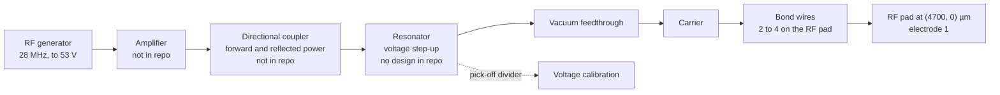
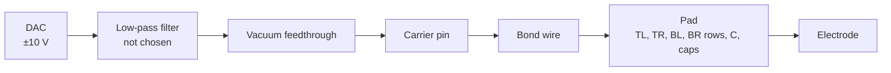
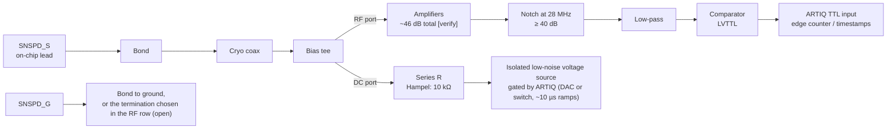

> **Claude-authored.** Equipment and wiring that each test needs on the bench, for the three device kinds the team can make, 2026-11-10.

[Test plan](../test_plan.md) · [Electrical tests](01_ELECTRICAL.md) · [Cryogenic tests](02_CRYOGENIC.md) · [Simpler testing](05_SIMPLER_TESTING.md) · [Open decisions](../OPEN_DECISIONS.md)

# Test setup: what has to be on the bench

## 1. What this page is

The equipment and the wiring that each test needs, for each device the team can make: the trap alone, the trap with an SNSPD, and an SNSPD alone.

Section 2 maps each device to its test IDs. Sections 3 and 4 give the three signal chains and the equipment list.

Section 5 marks which equipment each test needs. Section 6 lists what the lab has to confirm.

The repo does not describe the lab's cryostat, so every statement about it, and every lab item, is tagged `[verify]`.

## 2. Devices and stages

Test IDs come from [01_ELECTRICAL.md](01_ELECTRICAL.md) (a1 to a19, with its [Run applicability](01_ELECTRICAL.md#run-applicability) section), [02_CRYOGENIC.md](02_CRYOGENIC.md) (b1 to b10) and the [trapping checklist](04_TRAPPING.md).

| Device | Bare die or wafer, room temperature | Packaged, room temperature | Cold, in the trap cryostat |
|---|---|---|---|
| **Trap alone** (NODET, R1_TRAP) | Trap die: a1, a2. TEST_TRAP on the same run: a3 (T6), a5 (T1). Source: [01 Run applicability](01_ELECTRICAL.md#run-applicability). | a1, a2 through the carrier pins. [04_PACKAGING.md](../process/04_PACKAGING.md) step 19 asks for pad-to-pad isolation without naming IDs [inference]. a10 (LCR at 1 MHz). | Trapping checklist step 1, a1 and a2 only (a7, a8 and a19 need SNSPD pads). Steps 3 to 7, 10 and 12. [04_TRAPPING.md](04_TRAPPING.md) says to omit detector actions for NODET; the steps listed are the ones with no detector action [inference]. No b-test: the b-tests are for the SNSPD. |
| **Trap with SNSPD** (A30 or B60, R1_FULL) | Trap die: a1, a2, a7, a8, a19. Test die of the same run: a3, a5, a6, a7 (T4 / T4b), a12, a13, a14, a15 to a18 ([01 Run applicability](01_ELECTRICAL.md#run-applicability)). | a1, a2, a7 (SNS to SNG, [04_PACKAGING.md](../process/04_PACKAGING.md) step 19); a10. | Trapping checklist step 1: a1, a2, a7, a8, a19. Step 2: short repeat of b2, b4 and b6 on the trap die. Steps 3 to 12 with the detector. Test die: b1 to b5, b9 and b10 are written for the SNSPD and the T9 array, and [02_CRYOGENIC.md](02_CRYOGENIC.md) does not assign each one to a die [inference]. |
| **SNSPD alone** | Two candidates, described below the table. (i) T4 / T4b on the test die: a7, a8. (ii) Trap die with RF off: as for the trap die. | (i) a7, a8, only if the spare SNSPD pads can be wire-bonded (open). (ii) as for the trap die. | (i) b1, b2, b3, b4, b5, b9 on T4 / T4b. (ii) b2, b4, b5, which [02](02_CRYOGENIC.md) states with RF off. RF on afterwards is b6 (b7 and b8 also need RF on [inference]). |

**Candidate (i): spare SNSPDs T4 and T4b on the test die.** Facts from the repo:
- T4 is the A30 meander and T4b the B60 meander. Each sits on its own local Al mirror and has its own mirror probe pad ([LAYOUT.md](../LAYOUT.md), test structures table).
- The test die exists only in R1_FULL. TEST_TRAP has no NbN ([GLOSSARY.md](../../GLOSSARY.md), TEST_TRAP row).
- Whether the SNSPD pads can be wire-bonded is an open item: [OPEN_DECISIONS.md](../OPEN_DECISIONS.md#before-r1_full) ("Confirm test-die detector pads can be bonded for cold tests").
- The repo disagrees with itself here. [LAYOUT.md](../LAYOUT.md) line 67 says "Test dies have no bond pads". [02_CRYOGENIC.md](02_CRYOGENIC.md) line 11 says to bond the SNSPD and mirror probe pads "as laid out in `test_die_v4.gds` [verify pad sizes and bond fit]".
- [02_CRYOGENIC.md](02_CRYOGENIC.md) line 11 names "a dipstick or the trap cryostat" for the cold test. The team has the trap cryostat only (team report, 2026-11-10) [verify].

**Candidate (ii): an A30 or B60 trap die in the trap carrier with RF off.** The die already has the SNS and SNG bond pads ([LAYOUT.md](../LAYOUT.md), readout zone table; the pads sit at (−4750, ±100) µm). So the repo has no new layout for this candidate. Turning the RF on afterwards is b6 ([02_CRYOGENIC.md](02_CRYOGENIC.md), b6). The carrier and socket are open (section 6, question 1).

## 3. Three signal chains

Each chain is drawn element for element from its source page. The "Confirmed?" column is `[verify]` on every row, because no repo file states that the lab has any of these items.

### 3.1 RF drive chain

Elements and numbers come from [04_TRAPPING.md](04_TRAPPING.md) (steps 1 and 3), [04_PACKAGING.md](../process/04_PACKAGING.md) (step 19, RF pad bonds) and [OPEN_DECISIONS.md](../OPEN_DECISIONS.md) (resonator Q with a die mounted). The repo contains no resonator design, and no directional coupler, amplifier or feedthrough is specified for this chain.

| Element | What it does | Value or spec in the repo | Source | Confirmed? |
|---|---|---|---|---|
| RF generator | Sets the drive frequency and amplitude | 28 MHz. Ramp to 53 V (operating amplitude). b6 sweeps 0 to 70 V. | [04_TRAPPING.md](04_TRAPPING.md) step 3; [02_CRYOGENIC.md](02_CRYOGENIC.md) b6 | [verify] |
| Amplifier | Raises the generator output to what the resonator needs | Not in the repo. No gain or power is given. | none | [verify] |
| Directional coupler | Reads forward and reflected power | Not in the repo. The only directional couplers in the source notes are for cancellation tones in Slichter 2017, not the drive ([T2 note](../../research/research_notes/Test%20setup%202026-11/T2_snspd_bench_tests.md), [verify]). | none | [verify] |
| Resonator | Steps the voltage up at 28 MHz | No resonator design exists in the repo. Frequency and loaded Q with a die mounted are open. | [OPEN_DECISIONS.md](../OPEN_DECISIONS.md#before-any-v4-run); [04_TRAPPING.md](04_TRAPPING.md) step 1 | [verify] |
| Pick-off divider | Gives the voltage reading used to calibrate the drive | Calibrated before cooling. Ratio not in the repo. | [04_TRAPPING.md](04_TRAPPING.md) step 1 | [verify] |
| Vacuum feedthrough | Carries RF into the chamber | Number and type not in the repo. Pad isolation is checked through the feedthroughs. | [04_TRAPPING.md](04_TRAPPING.md) step 1 | [verify] |
| Carrier | Holds the die and carries its pins | Open: PGA84L-like 84-pin, 100-pin CPGA, or the lab carrier. | [04_PACKAGING.md](../process/04_PACKAGING.md) step 19; [OPEN_DECISIONS.md](../OPEN_DECISIONS.md) (Carrier row) | [verify] |
| Bond wires | Connect the carrier pin to the RF pad | Au wire on Au pad. 2 to 4 wires in parallel on the RF pad. | [04_PACKAGING.md](../process/04_PACKAGING.md) step 19 | [verify] |
| RF pad | Electrode 1 | (4700, 0) µm, 200 × 200 µm, Au | [LAYOUT.md](../LAYOUT.md) (floorplan table); [04_PACKAGING.md](../process/04_PACKAGING.md) step 19 | [verify] |

### 3.2 DC chain

Elements come from [CLAUDE.md](../../CLAUDE.md) (DAC range), [OPEN_DECISIONS.md](../OPEN_DECISIONS.md) (RF grounding and filters; transport waveform) and [04_TRAPPING.md](04_TRAPPING.md) (DC sets). No filter value is chosen. For the RC form and two literature pairs, see [RF primer section 6](../../primers/RF_PRIMER.md#6-filters-on-the-dc-lines).

| Element | What it does | Value or spec in the repo | Source | Confirmed? |
|---|---|---|---|---|
| DAC | Sets each electrode voltage | ±10 V. Model, update rate and resolution not in the repo. Transport needs an update rate above the 0.8 MHz axial frequency, or harder filtering. | [CLAUDE.md](../../CLAUDE.md) (key design numbers); [OPEN_DECISIONS.md](../OPEN_DECISIONS.md) (transport waveform) | [verify] |
| Low-pass filter | Holds the electrode at RF ground and cuts DAC and cable noise | Not chosen. Literature: Dietl et al. used first-order RC filters with a 5 kHz corner ([T1 note](../../research/research_notes/Test%20setup%202026-11/T1_dietl_2025.md), Sec. 4.2, page 9, read from the PDF). | [OPEN_DECISIONS.md](../OPEN_DECISIONS.md) (RF grounding / filters); [RF primer section 6](../../primers/RF_PRIMER.md#6-filters-on-the-dc-lines) | [verify] |
| Vacuum feedthrough | Carries DC into the chamber | Number not in the repo. | [04_TRAPPING.md](04_TRAPPING.md) step 1 | [verify] |
| Carrier pin | Connects the chamber wiring to the die | Carrier open. Pin map not in the repo. | [04_PACKAGING.md](../process/04_PACKAGING.md) step 19 | [verify] |
| Bond wire | Connects the carrier pin to the chip pad | Au wire on Au pad. | [04_PACKAGING.md](../process/04_PACKAGING.md) step 19 | [verify] |
| Pad | Chip contact for one electrode | One pad per DC electrode. Pad list in [trap_die_v4_A30_pads.csv](../../gds/trap_die_v4_A30_pads.csv). | [LAYOUT.md](../LAYOUT.md) (pad rows) | [verify] |
| Electrode | The DC electrode | Electrodes 2 to 36 (2 = centre DC). | [CLAUDE.md](../../CLAUDE.md) (electrode numbers) | [verify] |

### 3.3 SNSPD bias and readout chain

Copied from [03_READOUT.md](03_READOUT.md). For the circuit basics, see [RF primer section 7](../../primers/RF_PRIMER.md#7-the-snspd-as-a-circuit-and-its-readout-chain).

| Element | What it does | Value or spec in the repo | Source | Confirmed? |
|---|---|---|---|---|
| SNSPD_S on-chip lead | Carries the detector signal and bias off the chip | Au lead in the centre-DC slot, 5 µm wide ([LAYOUT.md](../LAYOUT.md), readout zone table) | [03_READOUT.md](03_READOUT.md) | [verify] |
| Bond | Chip to cable | Wedge bond on the SNSPD pads | [04_PACKAGING.md](../process/04_PACKAGING.md) step 19 | [verify] |
| Cryo coax | Carries signal and bias to the room-temperature bias tee | Number and type not in the repo | [03_READOUT.md](03_READOUT.md) chain | [verify] |
| Bias tee | Splits DC bias from the fast pulse | Room-temperature or cold placement not stated | [03_READOUT.md](03_READOUT.md) chain | [verify] |
| Amplifiers | Raise the pulse for the comparator | ~46 dB total | [03_READOUT.md](03_READOUT.md) (Gain row, "verify gain in Todaro Supp. Fig. S2/S3") | [verify] |
| Notch | Removes the RF pickup at 28 MHz | ≥ 40 dB at 28 MHz | [03_READOUT.md](03_READOUT.md) (Notch row) | [verify] |
| Low-pass | Removes what the notch leaves | Corner not chosen. [03_READOUT.md](03_READOUT.md) proposes a lower corner of ~10 to 15 MHz, tagged [inference] there. | [03_READOUT.md](03_READOUT.md) (Low-pass row); [RF primer section 7](../../primers/RF_PRIMER.md#7-the-snspd-as-a-circuit-and-its-readout-chain) | [verify] |
| Comparator | Turns the pulse into a logic edge | Threshold about 50 % of mean pulse height; tune on the b4 histogram | [03_READOUT.md](03_READOUT.md) (Comparator row) | [verify] |
| ARTIQ TTL input | Counts edges in the readout gate and time-tags them | LVTTL edges. Time-tags give the RF-photon correlation of step 9. | [03_READOUT.md](03_READOUT.md) (ARTIQ note) | [verify] |
| DC port and series R | Feeds the bias current | Series R 10 kΩ (Hampel), listed in the repo as a Hampel value | [03_READOUT.md](03_READOUT.md) chain | [verify] |
| Bias source | Isolated low-noise voltage source, gated by ARTIQ | Gated with ~10 µs ramps (DAC or switch); b9 uses 10 µs ramps | [03_READOUT.md](03_READOUT.md) chain; [02_CRYOGENIC.md](02_CRYOGENIC.md) b9 | [verify] |
| Bias gate | Turns the bias on only during readout | Bias off during loading, photoionisation and Raman or sideband work | [03_READOUT.md](03_READOUT.md) (Bias gate row) | [verify] |
| SNSPD_G and termination | Return side of the detector | Ground, or the termination chosen in the RF row. That choice is open. | [03_READOUT.md](03_READOUT.md) (RF grounding row); [OPEN_DECISIONS.md](../OPEN_DECISIONS.md) | [verify] |

## 4. Equipment list

Only instruments that the repo's test pages or the trapping checklist name are listed. A test that needs something no page names is in section 6. "Used by" gives test IDs, or the page where the item appears when no test ID applies.

| Item | Used by which tests | Spec the repo asks for | Where the repo says it comes from | Have it? |
|---|---|---|---|---|
| Probe station, ProbeStation-Summit-11000 | a1, a2, a3, a5, a6, a7, a8, a12 to a19 on the wafer and test dies | Manual probing [verify]; probe one end of each pad and bond the other | [01_ELECTRICAL.md](01_ELECTRICAL.md) (Tool); [RUNSHEET_R1_TRAP.md](../RUNSHEET_R1_TRAP.md) step 17; [design/CLAUDE.md](../../CLAUDE.md) names MIT.nano as the fab facility. The repo does not say which tool room has the probe station. | [verify] |
| Source-measure units (SMU) | a1 (300 V), a2 (50 V, ≤ 100 nA), a3 (1 mA), a5 (50 V; 300 V on sacrificial dies only), a6 (≤ 1 µA), a7 (≤ 1 V, ≤ 100 nA), a8 (≤ 1 V, > 1 GΩ), a12 and a14 (≤ 1 V, ≤ 100 nA), a13 (10 mA), a15 (50 V), a19 (≤ 10 V to C) | Voltage and current limits as listed; SNSPD never above 1 V or 100 nA | [01_ELECTRICAL.md](01_ELECTRICAL.md) (per-test stimulus lines; safety rules) | [verify] |
| LCR meter at 1 MHz | a10 (packaged), a15 (T2v capacitance) | 1 MHz. "LCR availability" flagged in a15. | [01_ELECTRICAL.md](01_ELECTRICAL.md) a10, a15; [GLOSSARY.md](../../GLOSSARY.md) (LCR) | [verify] |
| Optical microscope (darkfield for hillocks) | Optical inspection (no test ID; [05_SIMPLER_TESTING.md](05_SIMPLER_TESTING.md) tier 0); chipping check at dicing; hillock check on Al | Chipping < 50 µm [verify]; Au and Al ≥ 90 µm from the dicing edge; darkfield for hillocks and particles | [RUNSHEET_R1_TRAP.md](../RUNSHEET_R1_TRAP.md) step 18; [04_PACKAGING.md](../process/04_PACKAGING.md) step 18; [process_checks.md](../process_checks.md) rows 0 and 3 | [verify] |
| Trap cryostat (about 5 K, with the Ba oven, lasers and ARTIQ control) | b1 to b10; trapping checklist | Base temperature; b2 runs from base to 7 K; b10 at 2 K and 5 K | [02_CRYOGENIC.md](02_CRYOGENIC.md) b2 and b10; the 5 K figure is a team report, 2026-11-10 | [verify] |
| Thermometry near the chip | b1 (R vs T), b2 (I_sw vs T), b8 (ΔT), b10 (2 K and 5 K) | Not named in the repo. Temperature is needed for b8 (ΔT) and to set b2 at each temperature. | [02_CRYOGENIC.md](02_CRYOGENIC.md) (table rows); no thermometer named [inference] | [verify] |
| Cryostat DC lines | b1 (two DC lines); trapping steps 4 to 7 (electrodes); pre-cool isolation through the feedthroughs | Number not in the repo | [02_CRYOGENIC.md](02_CRYOGENIC.md) b1; [04_TRAPPING.md](04_TRAPPING.md) steps 1, 4 to 7 | [verify] |
| Cryostat RF coax and readout chain | b2 to b10; a1, a7, a8, a19 at pre-cool | Bias tee, amplifiers, notch, low-pass, comparator, ARTIQ TTL input (3.3) | [03_READOUT.md](03_READOUT.md) | [verify] |
| Carrier at room temperature (breakout) | a1, a2, a7 and a10 on the packaged die; repeat of isolation after packaging | Carrier open | [04_PACKAGING.md](../process/04_PACKAGING.md) step 19; [OPEN_DECISIONS.md](../OPEN_DECISIONS.md) (Carrier) | [verify] |
| RF generator | b6 to b8; trapping step 3 | 28 MHz; amplitude 0 to 70 V in b6; 53 V operating | [02_CRYOGENIC.md](02_CRYOGENIC.md) b6; [04_TRAPPING.md](04_TRAPPING.md) step 3 | [verify] |
| RF amplifier | b6 to b8; trapping step 3 | Not specified in the repo | none | [verify] |
| RF resonator | b6 to b8; trapping steps 1 and 3 | Frequency 28 MHz. Q not measured. No design in the repo. | [OPEN_DECISIONS.md](../OPEN_DECISIONS.md) (before any v4 run); [04_TRAPPING.md](04_TRAPPING.md) step 1 | [verify] |
| RF pick-off divider | Trapping step 1 (calibration of the drive voltage) | Ratio not in the repo | [04_TRAPPING.md](04_TRAPPING.md) step 1 | [verify] |
| DACs | Trapping steps 4, 6 and 7 (DC sets, transport); pre-cool | ±10 V; update rate above 0.8 MHz; resolution not in the repo | [CLAUDE.md](../../CLAUDE.md); [OPEN_DECISIONS.md](../OPEN_DECISIONS.md) (transport) | [verify] |
| Bias source (isolated low-noise voltage source) | b2 to b10 | Series R 10 kΩ (Hampel value); ~10 µs ramps | [03_READOUT.md](03_READOUT.md); [02_CRYOGENIC.md](02_CRYOGENIC.md) b9 | [verify] |
| Bias tee | b2 to b10 | Two ports: RF and DC | [03_READOUT.md](03_READOUT.md) | [verify] |
| Amplifiers | b3, b4, b5 and the readout chain | ~46 dB total | [03_READOUT.md](03_READOUT.md) | [verify] |
| Notch filter | Readout chain | ≥ 40 dB at 28 MHz | [03_READOUT.md](03_READOUT.md) | [verify] |
| Low-pass filter | Readout chain | Corner not chosen | [03_READOUT.md](03_READOUT.md); [OPEN_DECISIONS.md](../OPEN_DECISIONS.md) | [verify] |
| Comparator | Readout chain | Threshold ~50 % of mean pulse height | [03_READOUT.md](03_READOUT.md) | [verify] |
| ARTIQ TTL input | Readout chain; b4; trapping step 9 | Edge count and time-tag | [03_READOUT.md](03_READOUT.md) | [verify] |
| Oscilloscope | b3 (pulse shape after the amplifier) | Bandwidth not in the repo | [02_CRYOGENIC.md](02_CRYOGENIC.md) b3 | [verify] |
| 493 nm light source for flood illumination | b4, b6 (b4 curves), b7, b10; trapping step 5 uses the cooling beams | Attenuated flood, through a fibre or window | [02_CRYOGENIC.md](02_CRYOGENIC.md) b4 | [verify] |
| Lasers for trapping | Trapping steps 5 and 11 | 493 + 650 nm cooling; photoionisation 791 + 337 / 450 nm or 553 / 554 + 405 nm; 614 nm deshelve | [04_TRAPPING.md](04_TRAPPING.md) steps 5 and 11 | [verify] |
| Shutters | b5 (light off, shutters closed); oven shutter in step 5 | Closed for dark counts | [02_CRYOGENIC.md](02_CRYOGENIC.md) b5; [04_TRAPPING.md](04_TRAPPING.md) step 5 | [verify] |

## 5. Test-by-equipment matrix

● = the test needs that equipment group, from the conditions its page states.

| Test | Probe station + SMU | LCR | Carrier breakout, room temperature | Cryostat DC lines (and thermometer) | Cryostat RF coax and readout chain | RF resonator | Light |
|---|---|---|---|---|---|---|---|
| a1 RF leakage | ● | | ● | ● | ● | | |
| a2 DC leakage | ● | | ● | ● | | | |
| a3 Continuity | ● | | | | | | |
| a5 Gap leakage | ● | | | | | | |
| a6 NbN Rsq | ● | | | | | | |
| a7 Meander R | ● | | ● | | ● | | |
| a8 SNSPD isolation | ● | | | | ● | | |
| a10 RF capacitance | | ● | ● | | | | |
| a12 Dose array | ● | | | | | | |
| a13 Ground link | ● | | | | | | |
| a14 Geometry array | ● | | | | | | |
| a15 Dielectric capacitor | ● | ● | | | | | |
| a16 Al strip | ● | | | | | | |
| a17 Via chain | ● | | | | | | |
| a18 Lead continuity | ● | | | | | | |
| a19 SNSPD lead to C | ● | | | ● | ● | | |
| b1 R vs T | | | | ● | | | |
| b2 I–V and I_sw | | | | ● | ● | | |
| b3 Pulse shape | | | | | ● | | |
| b4 Count vs bias, flood | | | | | ● | | ● |
| b5 Dark counts | | | | | ● | | |
| b6 RF on and off | | | | | ● | ● | ● |
| b7 Clicks, bias off | | | | | ● | ● | ● |
| b8 RF heating | | | | ● | ● | ● | |
| b9 Bias gating | | | | | ● | | ● |
| b10 T9 array | | | | ● | ● | | ● |

Notes to the matrix:
- The cryostat columns are marked for the cold tests (b-tests) and for the pre-cool repeats in [04_TRAPPING.md](04_TRAPPING.md) step 1 (a1, a2, a7, a8, a19). Other a-tests are room-temperature tests.
- The cryostat DC-lines column includes the thermometer leads. The repo names no thermometer [inference].
- The SNSPD bias runs through the bias tee's DC port, which is in the readout chain column.
- b9 does not state a light source. Its count-rate part needs light, so the light column is marked [inference].
- The trapping checklist, which this matrix does not cover, needs the DC lines, the RF resonator and the light for the ion (steps 3 to 7).

Smallest set of columns that covers each device:
- **Trap alone (NODET):** a1, a2, a3, a5 and a10 need the probe station, the LCR meter and the carrier breakout. The trapping checklist for NODET adds the cryostat DC lines, the RF resonator and the light.
- **Trap with SNSPD (A30 or B60):** the trap-die tests a1, a2, a7, a8, a19 and a10, and the cold b2, b4 and b6, need all seven columns. The cold tests need the cryostat RF column, the RF resonator for b6 to b8, and the light for b4 and b6.
- **SNSPD alone:** candidate (i), T4 / T4b, needs the probe station (a7, a8), the cryostat DC lines and readout chain (b1 to b5 and b9), and light (b4, b9). Candidate (ii), the trap die with RF off, needs the carrier breakout, the cryostat DC lines and readout chain, and light. Adding b6 to b8 for either candidate adds the RF resonator.

## 6. Questions for the lab

1. Which carrier and socket does the cryostat take: a PGA84L-like 84-pin package, a 100-pin CPGA, or the lab carrier? ([OPEN_DECISIONS.md](../OPEN_DECISIONS.md), Carrier row.)
2. How many DC lines reach the cold stage, and what temperature does that stage reach (the team report says about 5 K [verify])? Are the lines filtered, and where?
3. Is there a spare coaxial line from the cold stage to the SNSPD pads? Is there a bias tee, and is it cold or at room temperature?
4. Which amplifiers, notch filters and counters are available, and what is the total gain? Are ARTIQ TTL inputs free for the comparator output?
5. Is there an RF resonator? If there is one, what is its type, what is its frequency (the repo uses 28 MHz), what is its loaded Q with a trap die mounted, and how is the voltage calibrated? ([04_TRAPPING.md](04_TRAPPING.md) step 1; [OPEN_DECISIONS.md](../OPEN_DECISIONS.md).)
6. Is there a temperature sensor on or near the chip? What is the base temperature? (b2 runs from base to 7 K; b10 uses 2 K and 5 K.)
7. Can the 493 nm flood reach the detector through a window or a fibre, attenuated? If not, can an LED be mounted inside the cryostat? (Slichter 2017, Sec. 4 and Fig. 4, mounted an LED on the cold stage 36 mm from the chip; Hampel 2023, pages 2 to 3, used cryogenic LEDs for flood illumination; neither had an ion. Both checked against the PDF; [T2 note](../../research/research_notes/Test%20setup%202026-11/T2_snspd_bench_tests.md).)
8. Can the test die be mounted and bonded in the same carrier as a trap die? ([LAYOUT.md](../LAYOUT.md) line 67 says test dies have no bond pads; [02_CRYOGENIC.md](02_CRYOGENIC.md) line 11 says to bond them.)
9. What are the DAC model, its update rate and its resolution? The repo sets ±10 V and asks for an update rate above 0.8 MHz. ([CLAUDE.md](../../CLAUDE.md); [OPEN_DECISIONS.md](../OPEN_DECISIONS.md).)
10. How many DC and RF feedthroughs does the cryostat have, and what is the RF loss through them at 28 MHz? The drive needed for 53 V at the chip depends on it.
11. Is there a room-temperature check of the SNSPD pads at the lab before cooling (a7 and a8 need an SMU at ≤ 1 V)? The repo names only the probe station in [01_ELECTRICAL.md](01_ELECTRICAL.md) and does not describe a lab check.
12. What is the bandwidth of an oscilloscope that can sit after the amplifier (b3)?
13. Which lasers are available for the cooling, photoionisation and deshelving wavelengths listed in [04_TRAPPING.md](04_TRAPPING.md) steps 5 and 11?
14. Is an LCR meter at 1 MHz available for packaged dies (a10) and for the T2v capacitor (a15)? The page flags "LCR availability" [verify].
