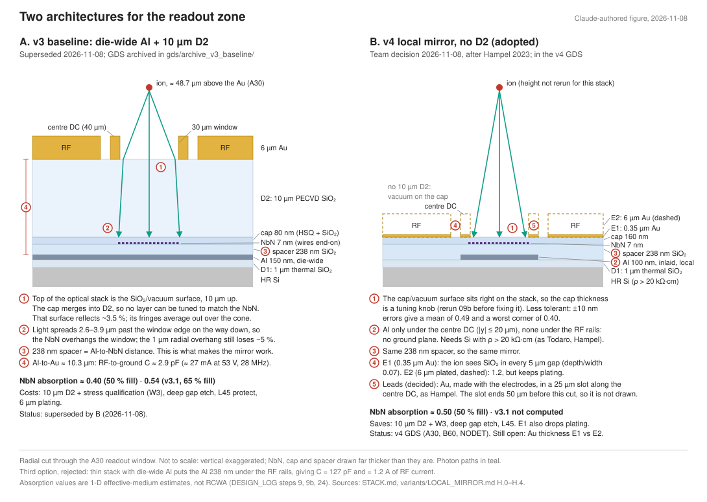

> **Claude-authored.** Reorganized 2026-11-08 from the project fabrication notes; mirror 100 nm inlaid 2026-11-09; raised mirror and current stack values 2026-11-12 (see the note below and the NbN leads section at the end).

# Local mirror without D2

[Variants](../VARIANTS.md) · [Open decisions](../OPEN_DECISIONS.md) · [Baseline](../TRAVELER.md)

> [!important] Adopted as v4 (team decision, 2026-11-08)
> The team chose this architecture, with the leads routed in a slot along the centre DC (H.5 option a, as Hampel 2023), and R1_TRAP on the same no-Al stack ([decisions](../../../notes/decisions.md)). `gds/make_chip.py` v4 implements it (DESIGN_LOG step 25): mirror |y| ≤ 20 µm from x = −2240 to +268 µm (readout at x = 240 since step 28), ground via at (−2140, 130) under the Au fill, just past the RF open end, Au leads 5 µm wide in a 25 µm slot, Ti/Au contacts from the NbN tabs into the slot. The H.5 list below is done; H.2 is the basis for the v4 traveler, which is not yet written. Still open: electrode Au (E1 vs E2), optics rerun (09b), RF pickup rerun (10).

> [!note] This page is the record of the argument; the process pages hold the current values (2026-11-09)
> [Stack](../STACK.md) and the [process pages](../TRAVELER.md#f-steps) were rewritten for v4 on 2026-11-09 (DESIGN_LOG step 36). Where this page differs from them, they are right:
> - the SiO₂ over the wires is 160 nm, so the mirror via is ≈ 0.40 µm deep and the contact openings ≈ 160 nm (H.2 step 11v below was written with the earlier 80 nm cap and is updated to these values);
> - the trap dies have no mirror probe opening: the mirror ground path is measured on the test die (T10 strip, T11 via chain; step 35);
> - the H.5 GDS changes were made in `gds/make_chip.py` v4, with the leads in the slot (option a).
> - The mirror thickness and step 3 were changed on 2026-11-09 (100 nm, inlaid). [process/01_FOUNDATION.md](../process/01_FOUNDATION.md) was current on 2026-11-09. It was not updated for the raised mirror of 2026-11-12 [verify].
> - **Current values, 2026-11-12** (team decisions in [notes/decisions.md](../../../notes/decisions.md)): the mirror is 100 nm of Al, raised on the base SiO₂ (was inlaid). The SiO₂ under the electrodes is about 1.35 µm (1.0 µm thermal, 238 nm spacer, 110 nm cap: 1.348 µm). Between the Au and the Al off the wires it is 348 nm. The marks are written in Al with layer 10. The cap is 160 ± 10 nm over the wires only; the contact openings cross 110 nm. The sections below keep the 2026-11-08 and 2026-11-09 values as the record.

Team request, 2026-11-08 (DESIGN_LOG step 23). Written as an alternative to the [baseline traveler](../TRAVELER.md) and adopted the same day.

**Idea.** Follow Hampel 2023: the Al sits only under the SNSPD and along its leads, never under the RF rails. The electrodes sit on the thin optical stack. Both options remove 10 µm D2 and its deep gap etch. **E1 removes plating; E2 retains 6 µm plating.** A die-wide Al plane under electrodes on that thin stack would give C_RF–ground ≈ 127 pF instead of 2.9 pF (DESIGN_LOG step 22) [team calc]. That is why the mirror has to be local.

## H.0 Why the baseline has a thick D2: ground plane and mirror together

The Al does two jobs, and each one depends on a different distance:

- **Mirror:** the Al-to-nanowire distance. This is the 238 nm SiO₂ spacer, fixed by the 493 nm cavity phase (DESIGN_LOG steps 9 and 9b).
- **RF ground plane:** the Al-to-electrode distance. The RF Au and the Al form a parallel-plate capacitor, C = ε·A/d. The rail area is fixed (0.877 mm² on A30), so d is the only free parameter. A thicker D2 also raises the RF breakdown voltage.

| Stack | Ground plane under the RF | SNSPD mirror | C_RF–ground; RF current at 53 V, 28 MHz [team calc] | Cost |
|---|---|---|---|---|
| **Baseline: thick D2** (the [baseline traveler](../TRAVELER.md)) | Yes | Yes | 2.9 pF (10.3 µm SiO₂); ≈ 27 mA | 10 µm D2, plating, gap etch. The detector sits under a 6 µm-deep window; the ion drops 1.38 µm (A30) over the window (step 17). The window floor is bare SiO₂ |
| Thin stack, die-wide Al (FabuBlox flow as drawn) | Yes, but too close | Yes | 127 pF (238 nm SiO₂); ≈ 1.2 A | The RF resonator cannot drive it; loss and breakdown in the SiO₂ |
| **Thin stack, local mirror** (this section) | No | Yes | Only the rail-to-Si capacitance, not computed | Needs Si with ρ > 20 kΩ·cm; the RF over that Si is NIST practice (Todaro, Hampel). Exposed SiO₂ in every gap unless the electrodes are plated thick, as Todaro's 6 µm were (H.4, option E2). Simpler process |

The choice is therefore between process complexity and the ground plane. A thick D2 gives both the plane and the mirror; a thin stack keeps the mirror only by removing the Al from under the RF rails. On Si with ρ > 20 kΩ·cm, dropping the plane is what NIST does (Todaro, Hampel). The 10 µm D2 is the standard surface-trap ground-plane stack (Romaszko 2020 Fig. 3.1; JoVE; Stick 2010; Leibrandt 2009; Sterling 2014 with 10 µm of buried SiO₂).

The thickness of the SiO₂ under the electrodes changes the load on the RF drive and the field inside that SiO₂. It does not change the trapping field at the ion, which the electrode widths set.

## H.1 Mirror size

Hampel gives no dimensions. Measured from Hampel Fig. 1 (arXiv v1, p. 2) against its 20 µm and 100 µm scale bars [team calc]. The 20 × 30 µm SNSPD outline measures 20 × 30.5 µm, which checks the scale.

| | Hampel, small mirror | Hampel, large mirror | **This variant (proposal)** |
|---|---|---|---|
| Along the leads | ≈ 64 µm: 13 µm behind the active area, 20 µm forward under the lead start | ≥ 270 µm along the lead channel; runs ≈ 160 µm past the RF-rail ends | Small part: x = 265 … 328 (X_READ = 300; the meander tabs end at x = 245). Large part: continues under the leads to x ≈ −2400, i.e. ≈ 400 µm past the RF open end at x = −2000 |
| Across | 37–49 µm (visible edge to the black RF gaps) | ≈ 35–50 µm | **\|y\| ≤ 20 µm (40 µm)**: under the centre DC only. Our RF rails start at \|y\| = 25, so 50 µm is the hard limit |
| Margin around the detector | 8–15 µm on the long sides | – | **≈ 4 µm** on the long sides (detector \|y\| ≤ 16, mirror \|y\| ≤ 20). Narrower than Hampel's because our channel is 50 µm wide |
| Under the RF rails | No | No | No, by construction |
| Ground | CHF₃ vias + 20 nm Au, "via the trap electrodes" | same | Widen the far end (x ≈ −2500 … −2300) to reach under the Au ground fill and put the via there (H.2 step 11v). Exact spot to be checked in the GDS: the fill must enclose it ≥ 25 µm, as in step 22 |

Capacitance the mirror adds to the centre DC (electrode 2), which sat 398 nm above it on the 2026-11-08 stack (238 nm spacer + 160 nm HSQ/cap): 40 µm × ≈ 2.73 mm ≈ **9.5 pF** [team calc, ε_r 3.9]. With 348 nm between them (238 nm spacer + 110 nm cap, 2026-11-12), the same formula gives about **10.8 pF** [team calc; not simulated]. That is harmless on a filtered DC line [inference].

## H.2 Steps (changes against the [baseline recipes](../TRAVELER.md#f-steps))

| Step | Baseline | Variant |
|---|---|---|
| 0–2 | Prep, L1 marks, 1 µm thermal SiO₂ (D1) | Same |
| **3v** | L10 inverted: die-wide plane | **L10 drawn: local mirror only**. Evaporated Al **100 nm, raised** on the base SiO₂: Al evaporation and lift-off with one resist, exposed together with layer 1 for the marks (team decision 2026-11-12; was inlaid, team decision 2026-11-09, `sim/10c`, DESIGN_LOG step 37; the 450 nm of 2026-11-08 came before that). Hampel used 50 nm e-beam Al by lift-off, not inlaid (raised; [verify] against Hampel 2023). No mark cut-outs needed |
| 4–8 | Spacer 238 nm, NbN, L22 leads, L20 nanowire, HSQ + cap | Same order: leads before the nanowire, cap straight after. **The cap is now the top surface over the detector (vacuum above)**, so its thickness matters optically again: the cap was fixed at 160 nm (sim 09c, DESIGN_LOG step 26; 09b is superseded) (H.4). From 2026-11-12 the cap is 110 nm blanket, which gives 160 ± 10 nm over the wires with the HSQ |
| 9, 10 | 10 µm D2 | **Skipped** |
| **11v** | L40 through ≈ 10.4 µm D2 | **L40 through the thin stack only.** Mirror ground via: 110 nm cap + 238 nm spacer = 348 nm down to the Al (2026-11-12; was ≈ 0.40 µm). SNSPD contact openings: 110 nm down to the L22 Au (was ≈ 160 nm). Thin positive resist (~1.3 µm); same CHF₃/CF₄/Ar chemistry, ≈ 1 min [verify]. Stops on Al and Au. No mirror probe opening on the trap dies. The mirror is checked on the test die: T10 for the strip, T11 for the via ([step 11](../process/03_ELECTRODES.md#11-layer-40-openings-through-the-thin-stack)) |
| **12v–15v** | Seed, nLOF mold, 6 µm plating, seed removal | **Ti/Au lift-off electrodes, L50 drawn**: LOR + positive resist, MLA. In-situ Ar pre-clean before the Ti (AlF₃ on the via floor; step 22). Ti 10 nm / Au 350 nm (Hampel 350 nm) [verify thickness]. Lift-off in NMP. Option E2: keep steps 12–15 as written and plate 6 µm on the thin stack; the cap protects the NbN under the plating resist (Todaro's damage step) [inference] |
| 16a, 16 | L45 protect, gap etch | **Skipped** (no D2 to clear) |
| 17–19 | Test, dice, package | Same, except: no M1 bond openings (the mirror is grounded through the fill); fill ↔ mirror on the test die: T10 strip 18.8–25.1 Ω expected at 100 nm (`sim/10c`, step 37; [step 11](../process/03_ELECTRODES.md#11-layer-40-openings-through-the-thin-stack)); acceptance not set [verify]; check that 350 nm evaporated Au wedge-bonds [verify] |

Thermal budget: no D2, so the long 300 °C exposure goes away.

## H.3 Cross-section under the readout window (variant)

HR Si / 1.0 µm thermal SiO₂ / 100 nm Al, raised (local mirror; 2026-11-12, was inlaid) / 238 nm PECVD SiO₂ spacer / 7 nm NbN / 160 nm over the wires (HSQ + 110 nm PECVD SiO₂ cap; step 26 had 80 nm) / **vacuum**. For E1/A30 the window is a 30 × 30 µm hole in 0.35 µm Au; E2 retains 6 µm Au. The ion sees the cap directly. Away from the detector the electrodes sit on spacer + cap over D1, with no Al under them.

## H.4 What the variant changes in the physics (each needs a rerun or a test)

- **RF over thin SiO₂ on HR Si, with no ground plane.** This is proven NIST practice, not an open risk. Todaro trapped on 6 µm plated Au over 134 nm PECVD SiO₂ on intrinsic Si, ρ > 20 kΩ·cm, with no ground plane, and reached days-long lifetimes and F = 0.9991. Hampel used the same kind of substrate. The ground plane in the baseline comes from the Romaszko/JoVE flow (Romaszko 2020 Sec. 3.2; Leibrandt 2009: Q 100 → 150 with the plane), which guards against substrate loss. **Condition: order Si with ρ > 20 kΩ·cm, as NIST did.** The baseline step 0 asks only for > 10⁴ Ω·cm. Measuring the resonator Q with the die mounted is still worth doing.
- **Exposed SiO₂ in every gap.** 0.35 µm Au over 5 µm gaps gives a depth-to-width ratio of 0.07, against ≥ 1 recommended (Bautista-Salvador 2019). The ion sees SiO₂ along the whole trap, not only at the window. Todaro trapped on the same NIST design with 6 µm electrodes; Hampel's paper reports no trapping. Option E2 (plated 6 µm) raises the ratio to 1.2.
- **Optics (09b).** Rerun with vacuum above the cap instead of 10 µm SiO₂.
- **Ion height and recess (04b, 12).** Set `metal_thickness` to 0.35 (or 6 for E2) and `ground_depth: null` (no buried ground) in the `_sim.json`. The window recess shrinks from 6 µm to 0.35 µm, so the 1.4 µm height drop over the window should shrink as well [inference; rerun 04b].
- **RF pickup (10).** Rerun with a local mirror, no D2, and the rail 5 µm laterally from the mirror edge.

## H.5 GDS changes needed (not made)

A `--localmirror` flag in `make_chip.py` would need:

- L10 = the H.1 mirror shape, not the die-wide plane;
- L40 = the mirror ground via + SNSPD pad openings + a mirror probe opening only (no M1 bond openings, no fill-to-M1 vias);
- no L45;
- `_sim.json` stack per H.4;
- **a lead-routing decision.** The L22 leads now run under the centre DC with only the thin HSQ/cap (80 nm when this was written) between them and the Au, over ≈ 2.3 mm inside the trap and ≈ 2.6 mm under the centre lead. A pinhole anywhere shorts the SNSPD to electrode 2. Either (a) move the leads into the electrode layer, in a slot cut along the centre DC (Hampel's Fig. 1 layout; a GDS change and a new five-wire geometry to simulate), or (b) keep them buried and thicken the SiO₂ over the leads only [inference; adds a step].
- `check_chip.py` rules for the above.

## NbN leads (considered 2026-11-12, not built)

A team member was told that SNSPD leads can also be made of NbN. Three versions were considered. No GDS was written for any of them.

- **(a) Keep the Au slot leads and thin Ti/Au contacts.** Chosen for this run (team decision 2026-11-12, [notes/decisions.md](../../../notes/decisions.md)). No layout change.
- **(b) NbN from each tab into the slot, so that no Ti/Au lies under the centre-DC Au.** Ti/Au only as a pad in the slot. Changes layers 20 and 22 of A30 and B60; the electrode Au is unchanged. Option for a later run; not decided [verify].
- **(c) NbN leads along the whole 2.2 mm slot, under the SiO₂ cap, with the Au strips as grounded shields and the contacts outside the trap.** No lead resistance (the Au leads are 69 Ω each on E1 at room temperature, DESIGN_LOG step 31). The leads are enclosed between a grounded mirror and grounded Au. But it reverses the 2026-11-08 slot-lead decision, adds stitched 2.2 mm e-beam lines, and needs a new pickup simulation and layout checks. Option for a later run; not decided [verify].

In no version does the contact layer disappear. It is still needed as the etch stop for the openings (the fluorine plasma that opens the SiO₂ also etches NbN, and 7 nm cannot stop it) and for the e-beam crosses.
