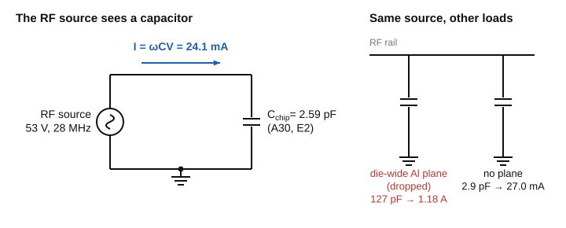
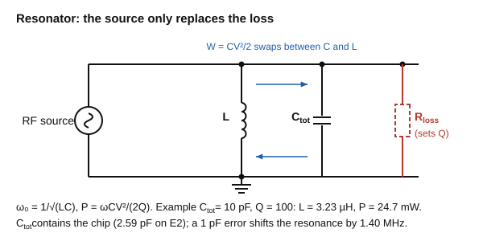
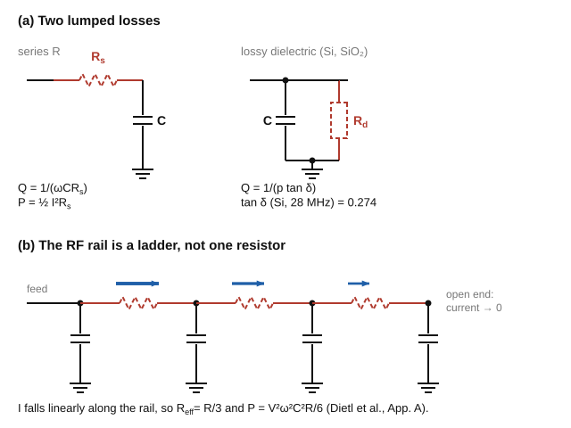
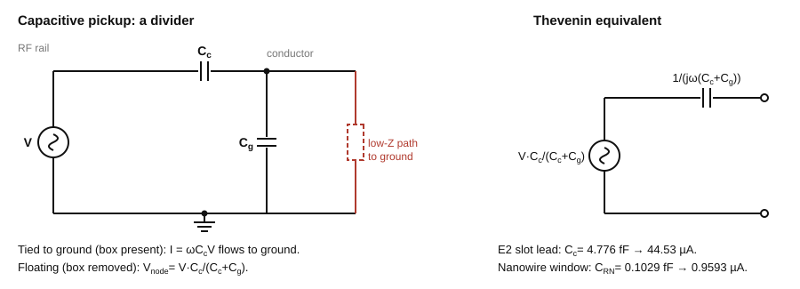
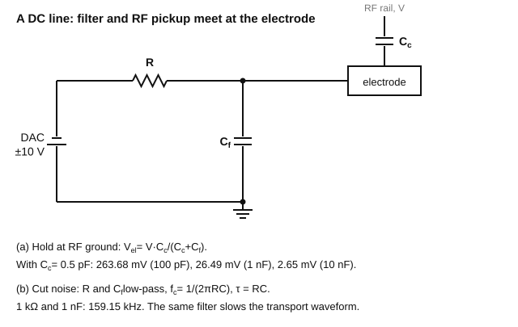
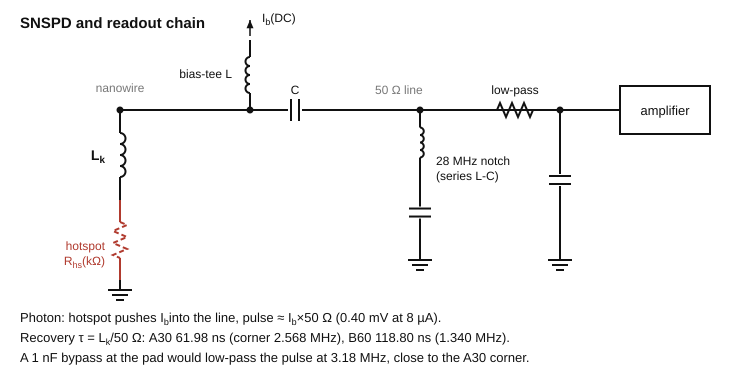
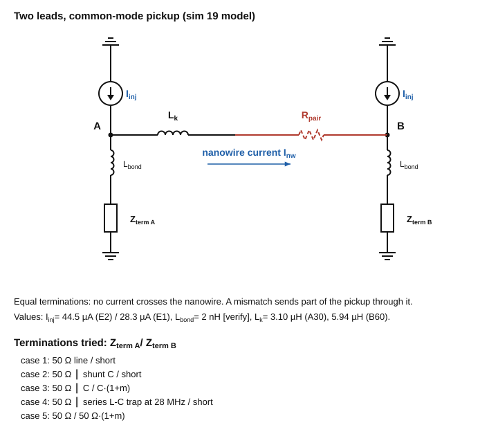
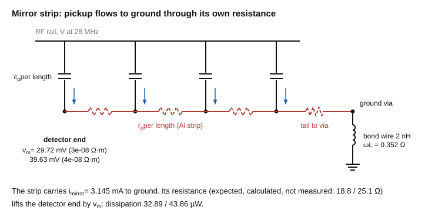

> **Claude-authored.** A basics primer on RF drive, loss, pickup, filters and SNSPD readout for this chip, 2026-11-10.

# RF, filtering and capacitance for this chip

One example runs through every section: the RF rail at 53 V (zero-to-peak) and 28 MHz. Every number on this page is printed by [`primer_numbers.py`](primer_numbers.py). Reproduce them from Git Bash:

```
cd design/sim && ./run.sh ../primers/primer_numbers.py
```

The circuit diagrams are drawn by [`make_circuit_figures.py`](make_circuit_figures.py) into `figures/` (`./run.sh ../primers/make_circuit_figures.py`). They are schematics with this page's numbers as labels; the script computes nothing. The figures are numbered after the sections that use them, so section 4 has no figure.

> **What to take away**
> 1. Current per pF: `I = ω C V`. At 53 V and 28 MHz, 1 pF draws 9.32 mA.
> 2. Power to hold the voltage: `P = ω C V² / (2Q)`. Example: 10 pF and Q = 100 gives 24.7 mW.
> 3. Pickup current: a conductor coupled through C_c draws `I = ω C_c V`. Slot lead on E2: 44.53 µA.
> 4. RC corner: `f_c = 1 / (2π R C)`. 1 kΩ and 1 nF: 159.15 kHz.
> 5. Pulse time constant of the SNSPD: `τ = L_k / 50 Ω`. A30: 61.98 ns.

---

## 1. The chip is a capacitor

To the RF source, the trap is mostly a capacitor. A capacitor has impedance `Z = 1 / (jωC)`, so at a fixed voltage the current is set by C and by how fast the voltage swings. You can get the first answer without any of the trap's geometry.

Formula: `I = ω C V`, with `ω = 2πf`.



*Left: the circuit the source sees. Right: the same rail with the die-wide Al plane on the thin stack, and with the thick 10 µm D2 baseline.*

> **On this chip:** ω = 1.7593e+08 rad/s at 28 MHz. I per pF at 53 V is 9.32 mA; per fF it is 9.32 µA.
> The chip's own RF capacitance, from sim 22 with the Si treated as a lossless dielectric (the cold case): 2.59 pF for A30 on E2, which draws 24.1 mA, and 2.39 pF on E1, which draws 22.3 mA. On E2, 0.63 of the field energy is in the Si and 0.20 in the SiO₂; section 3 says why that matters.
> The die-wide Al plane was dropped for this reason. On the thin stack, a plane would give C_RF-ground = 127 pF, which is 1.18 A at 53 V and 28 MHz. The thick 10 µm D2 baseline (v3) has its plane 10.3 µm below the electrodes and 2.9 pF, which is 27.0 mA. Source: `fab/variants/LOCAL_MIRROR.md` for the capacitances; the currents are [team calc].

Where this shows up:
- [`../sim/22_rf_capacitance.py`](../sim/22_rf_capacitance.py) and its [table](../sim/out/22_rf_capacitance/table.md) (the chip capacitance, section by section)
- [`../fab/variants/LOCAL_MIRROR.md`](../fab/variants/LOCAL_MIRROR.md) (why the Al plane is local)

## 2. Why the drive needs a resonator

The stored energy `W = C V² / 2` moves back and forth between C and an inductor L at `ω0 = 1 / sqrt(LC)`. The source does not supply this energy; it only replaces what the circuit loses each cycle. So the power the source must supply is `P = ωW / Q = ω C V² / (2Q)`. A higher Q means less power for the same voltage. More C means more power.

Formulas:
- `W = C V² / 2`
- `P = ω C V² / (2Q)`
- `L = 1 / (ω² C_tot)` for a given total capacitance
- bandwidth `f0 / Q`
- `df / f = -dC / (2 C_tot)` for a capacitance error dC

When the source is matched (critically coupled), the loaded Q is half the unloaded Q.



*The tank: energy swaps between L and C; R_loss stands for every loss in section 3 and sets Q.*

> **On this chip (example C_tot = 10 pF, not the chip):** W = 14.04 nJ. Power for Q = 50: 49.4 mW; Q = 100: 24.7 mW; Q = 200: 12.4 mW; Q = 500: 4.9 mW. L = 3.23 µH. Bandwidth at Q = 100: 280 kHz. A 1 pF error in C_tot moves the resonance by -1.40 MHz.

Where this shows up:
- [`../research/research_notes/Bond%20pad%20sizing%20for%20ion%20traps/pad_electrical_effects.md`](../research/research_notes/Bond%20pad%20sizing%20for%20ion%20traps/pad_electrical_effects.md), section 2 (helical resonator model)
- [`../fab/tests/04_TRAPPING.md`](../fab/tests/04_TRAPPING.md) (measure resonator frequency and Q with the chip installed)

## 3. Where the Q goes (loss)

Independent loss mechanisms add as `1/Q = Σ 1/Q_i`.
- A series resistance R_s in the capacitor's current path dissipates `P = ½ I² R_s` and gives `Q = 1 / (ω C R_s)`.
- A dielectric holding a fraction p of the field energy, with loss tangent tan δ, gives `Q = 1 / (p tan δ)` and `P = ½ ω C V² p tan δ`.
- A resistive substrate acts like a lossy dielectric with `tan δ = 1 / (ω ε0 ε_r ρ)`.
- The RF rail is not one lumped resistor. The current enters at the feed and falls to zero at the open end as it charges the rail, so only part of the rail's resistance counts: for a current that falls linearly, the effective series resistance is one third of the end-to-end resistance R, and `P = V² ω² C² R / 6`. Derivation: Dietl et al., arXiv:2505.21284, Appendix A, Eqs. 10–12 ([reading pointers](../research/research_notes/Test%20setup%202026-11/T1_dietl_2025.md)).



*(a) The two lumped loss models. (b) The rail as a ladder: the current, and so the dissipation, is largest at the feed.*

The Si here is high-resistivity Si with ρ = 200 Ω·m (20 kΩ·cm, the lower spec in [`../CLAUDE.md`](../CLAUDE.md)), ε_r = 11.7.

> **On this chip:** tan δ of the Si at 28 MHz is 0.274. The same formula at 1 MHz gives 7.682. A loss tangent above 1 means the Si conducts more current than it stores: at 1 MHz and room temperature it behaves more like a resistor than a dielectric, and the small-loss formulas above no longer apply [inference]. This matters for a capacitance measured with a 1 MHz meter at room temperature (electrical test a10).
> The scale of the heating: P = ½ I² R for I = 9.32 mA and R = 1 Ω is 43.5 µW.
> Cold Si: [`../sim/10b_rf_pickup_v4.py`](../sim/10b_rf_pickup_v4.py) describes the Si as insulating at the 4–6 K detector temperature and treats the back side as grounded. Its docstring does not say "freeze-out", so the claim that the Si is lossless when cold rests on that wording [inference].

Where this shows up:
- [`../sim/10b_rf_pickup_v4.py`](../sim/10b_rf_pickup_v4.py) (the Si permittivity and the cold-Si wording)
- [`../sim/18_e1_vs_e2.py`](../sim/18_e1_vs_e2.py), part 3 (the RF heating bound)
- [`../fab/OPEN_DECISIONS.md`](../fab/OPEN_DECISIONS.md) (resonator Q with a die mounted)

## 4. Skin depth and sheet resistance (E1 versus E2)

Current in a conductor flows in a skin of depth `δ = sqrt(ρ / (π f μ0))`. If the film is thinner than δ, the current fills the whole thickness and the DC sheet resistance applies: `R_sq = ρ / t`. A line's resistance is `R_sq` times its number of squares (length over width).

> **On this chip:** Au bulk ρ = 2.44e-08 Ω·m, read from [`../sim/out/18_e1_vs_e2/summary.json`](../sim/out/18_e1_vs_e2/summary.json). The skin depth at 28 MHz is 14.86 µm.
> E1 (0.35 µm Au): R_sq = 0.0697 Ω/sq, t/δ = 0.024.
> E2 (6 µm Au): R_sq = 0.0041 Ω/sq, t/δ = 0.404.
> Both films are thinner than δ, so the DC sheet formula applies to both.
> One SNSPD slot lead, drawn length, room temperature, bulk ρ: 69.33 Ω (E1) and 4.04 Ω (E2).

Where this shows up:
- [`../sim/18_e1_vs_e2.py`](../sim/18_e1_vs_e2.py) and its summary
- [`../DESIGN_LOG.md`](../DESIGN_LOG.md), step 31

## 5. Capacitive pickup

A conductor near the RF rail shares a small mutual capacitance C_c with it. There are two limits:
- If it is held at ground through a low impedance, a current `I = ω C_c V` flows through it to ground.
- If it is floating, or behind a high impedance, it rides up to `V · C_c / (C_c + C_g)`, where C_g is its capacitance to ground. This is a capacitive divider.

In between, the conductor looks like a Thevenin source with voltage `V C_c / (C_c + C_g)` and impedance `1 / (jω (C_c + C_g))`.



*Left: the two limits (path to ground present or removed). Right: the Thevenin source for the in-between case.*

The floating case is the worst one. The team's rule is to keep the mirror tied to ground ([`../CLAUDE.md`](../CLAUDE.md), "Physics decisions not to undo": a floating ITO raised RF pickup, and the mirror ground via stays).

> **On this chip (E2, 100 nm inlaid Al mirror):** C_c per µm from the RF rail to the slot lead is 2.132 aF/µm. Over 2240 µm that is 4.776 fF, and I = 44.53 µA (the JSON value is 44.534 µA, agreeing to 0.1 %).
> The nanowire window: C_RN = 0.1029 fF gives I = 0.9593 µA, equal to the JSON I_pk_uA.

Where this shows up:
- [`../sim/10b_rf_pickup_v4.py`](../sim/10b_rf_pickup_v4.py) and [`../sim/10c_mirror_thickness.py`](../sim/10c_mirror_thickness.py)
- [`../sim/out/10c_mirror_thickness/summary.json`](../sim/out/10c_mirror_thickness/summary.json) (`al100_inlaid`, E2)
- [`../DESIGN_LOG.md`](../DESIGN_LOG.md), steps 10 and 26

## 6. Filters on the DC lines

A DC filter does two jobs:
- (a) it holds each DC electrode at RF ground, so that pickup does not make its voltage wiggle at 28 MHz;
- (b) it keeps DAC and cable noise at the ion's motional frequencies off the electrode.

Job (a) is the capacitive divider again, `V_el = V C_c / (C_c + C_f + C_g)`, where C_f is a filter capacitor to ground close to the chip and C_g is the electrode's own capacitance to ground (small once C_f is large). Job (b) is an RC low-pass with corner `f_c = 1 / (2π R C)`, attenuation `1 / sqrt(1 + (f / f_c)²)` at frequency f, and time constant `τ = RC = 1 / (2π f_c)`. A voltage step needs a few τ to settle. So the same filter that cuts noise also slows the transport waveform.



*One DC line. C_c brings RF in; C_f shunts it to ground (job a). R with C_f is the low-pass (job b).*

> **On this chip:** the centre DC couples to the rails through C_c = 0.414 pF, and it has C_g = 3.21 pF to ground ([sim 23](../sim/23_dc_rf_coupling.py), `per_electrode.E2.centre_A30`). These replace the 0.5 pF estimate from the SNSPD geometry audit that this page used earlier. With them, the RF voltage on the centre electrode is 211.93 mV for C_f = 100 pF, 21.88 mV for 1 nF and 2.20 mV for 10 nF. These are the sim's own divider values. Without C_g, the 1 nF case gives 21.95 mV.
> Literature RC pairs quoted in the repo:
> - 1 kΩ and 1 nF: f_c = 159.15 kHz; attenuation at the 0.8 MHz axial frequency is 0.1951.
> - 35 kΩ and 220 pF: f_c = 20.67 kHz; attenuation at 0.8 MHz is 0.0258.
> Time constants at the corners tried in [`../sim/20_transport_timing.py`](../sim/20_transport_timing.py): 10 kHz gives τ = 15.915 µs; 50 kHz gives 3.183 µs; 200 kHz gives 0.796 µs.

No filter values are chosen for this chip yet ([`../fab/OPEN_DECISIONS.md`](../fab/OPEN_DECISIONS.md), RF grounding and filters).

Where this shows up:
- [`../research/research_notes/Trap%20integrated%20SNSPD%20design/fivewire_design_rules.md`](../research/research_notes/Trap%20integrated%20SNSPD%20design/fivewire_design_rules.md) (the 1 kΩ / 1 nF pair, lines 18 and 76)
- [`../research/research_notes/Bond%20pad%20sizing%20for%20ion%20traps/pad_electrical_effects.md`](../research/research_notes/Bond%20pad%20sizing%20for%20ion%20traps/pad_electrical_effects.md) (the 35 kΩ / 220 pF pair, line 97)
- [`../sim/20_transport_timing.py`](../sim/20_transport_timing.py)
- [`../sim/23_dc_rf_coupling.py`](../sim/23_dc_rf_coupling.py) and its [summary](../sim/out/23_dc_rf_coupling/summary.json) (the centre DC coupling and divider; step 42)

## 7. The SNSPD as a circuit, and its readout chain

Superconducting, the nanowire is an inductor with kinetic inductance L_k. When a photon arrives, a short resistive section (kΩ) forms, and the bias current I_b is pushed into the 50 Ω readout line. The pulse height is about `I_b × 50 Ω`. The current then returns to the wire with time constant `τ = L_k / 50 Ω`, and the pulse has corner frequency `1 / (2π τ)`.

> **On this chip:** L_k from [`../gds/measured_v4.json`](../gds/measured_v4.json) (straight-section inductance).
> - A30: L_k = 3.10 µH, τ = 61.98 ns, pulse corner 2.568 MHz.
> - B60: L_k = 5.94 µH, τ = 118.80 ns, pulse corner 1.340 MHz.
> - Pulse height for I_b = 8 µA: 0.40 mV.
> - Nanowire impedance at 28 MHz, `ω L_k`: 545.2 Ω (A30) and 1045.0 Ω (B60), against 50 Ω.

Readout chain: a bias tee feeds the DC bias through an inductor and passes the fast pulse through a capacitor to the amplifier. A notch at 28 MHz removes the RF pickup before the amplifier saturates, and a low-pass removes what is left. The reference chain is [`../fab/tests/03_READOUT.md`](../fab/tests/03_READOUT.md).



*The readout chain in the order the signal meets it.*

Why "just bypass the RF with a capacitor at the pad" costs signal: a 1 nF capacitor across the 50 Ω line has reactance `1 / (ωC)` of 5.68 Ω at 28 MHz. It also low-passes the pulse at `1 / (2π · 50 Ω · C)`, which is 3.18 MHz. That is close to the 2.568 MHz pulse corner of A30 above.

Common mode versus differential: both leads pick up nearly the same RF current (section 5). Only the part that differs between the two leads flows through the nanowire. The A30 / E2 nanowire current from [`../sim/out/19_lead_termination/summary.json`](../sim/out/19_lead_termination/summary.json), rows with R_pair = 0 (upper bounds, lumped model):
- plain 50 Ω line with the return shorted to ground: 4.057 µA;
- 1 nF shunt on the A side: 0.465 µA;
- 28 MHz L-C trap ("4 trap nominal"): 0.0403 µA;
- symmetric 50 Ω / 50 Ω termination with 5 % mismatch: 0.2002 µA.



*The lumped model of sim 19. Z_term A and Z_term B are the terminations compared in the list above.*

Series L-C trap: its impedance is zero at `f0 = 1 / (2π sqrt(LC))`. For C = 1 nF at 28 MHz, L = 32.3 nH. The trap that sim 19 simulates uses C = 100 pF, which needs L = 323 nH.

The termination is an open decision ([`../fab/OPEN_DECISIONS.md`](../fab/OPEN_DECISIONS.md), RF grounding and filters).

Where this shows up:
- [`../fab/tests/03_READOUT.md`](../fab/tests/03_READOUT.md) (the readout chain)
- [`../sim/19_lead_termination.py`](../sim/19_lead_termination.py)
- [`../gds/measured_v4.json`](../gds/measured_v4.json)

## 8. Grounding and return current

Every RF current returns to its source. The impedance of the return path sets how far "ground" sits from 0 V.

The lead model in [`../sim/19_lead_termination.py`](../sim/19_lead_termination.py) assumes a 2 nH bond wire. That value is tagged [verify] in the source.



*The strip model of sim 10c: pickup enters along the strip and all of it leaves through the ground end.*

> **On this chip:** ωL for 2 nH at 28 MHz is 0.352 Ω.
> The Al mirror strip (100 nm inlaid Al, E2) is grounded at one far end. Its detector end sits tens of mV from ground because the return path has resistance. For the two resistivity keys in the sim, 3e-08 and 4e-08 Ω·m:
> - mirror current i_mirror = 3.194 mA for both;
> - t10 = 18.825 Ω and 25.100 Ω;
> - v_m = 30.19 mV and 40.25 mV;
> - p = 33.93 µW and 45.23 µW.
> Source: [`../sim/out/10c_mirror_thickness/summary.json`](../sim/out/10c_mirror_thickness/summary.json), `al100_inlaid`, E2.
> Model ([`../sim/10c_mirror_thickness.py`](../sim/10c_mirror_thickness.py), `derived()`): the RF current that the rail sends into the strip is a peak value, `i_mirror = ω V C_p L`, for a strip 2240 µm long plus a 140 µm tail to the via. The strip is 40 µm wide, with resistance ρ / (t × 40 µm) per length. Its current grows linearly from zero at the detector end to `i_mirror` at the via, so `v_m` is the peak swing at the detector end. The dissipation is `p = ½ i_mirror² R_eff` (peak current, time average), with `R_eff = r (L/3 + L_tail)`, where r is the resistance per length.

Where this shows up:
- [`../sim/10c_mirror_thickness.py`](../sim/10c_mirror_thickness.py)
- [`../DESIGN_LOG.md`](../DESIGN_LOG.md), steps 37 and 38

## 9. One-page cheat sheet

Every row is printed by `primer_numbers.py` (section 9 of its output).

| quantity | formula | value on this chip | printed by the script |
|---|---|---|---|
| current per pF | I = omega C V | 9.32 mA | yes |
| stored energy, example 10 pF | W = C V^2 / 2 | 14.04 nJ | yes |
| power for Q = 100, example 10 pF | P = omega W / Q | 24.7 mW | yes |
| pickup current, slot lead | I = omega C_c V | 44.53 uA | yes |
| pickup current, nanowire window | I = omega C_RN V | 0.9593 uA | yes |
| RC corner, 1 kohm / 1 nF | f_c = 1/(2 pi R C) | 159.15 kHz | yes |
| tan delta of Si, 28 MHz | 1/(omega eps0 eps_r rho) | 0.274 | yes |
| pulse time constant, A30 | tau = L_k/50 ohm | 61.98 ns | yes |

## 10. Where to read more

Inside the repo:
- [`../research/research_notes/Bond%20pad%20sizing%20for%20ion%20traps/pad_electrical_effects.md`](../research/research_notes/Bond%20pad%20sizing%20for%20ion%20traps/pad_electrical_effects.md), sections 2 to 4
- [`../research/research_notes/SNSPD%20geometry%20audit/rf_tolerance.md`](../research/research_notes/SNSPD%20geometry%20audit/rf_tolerance.md)
- [`../fab/tests/03_READOUT.md`](../fab/tests/03_READOUT.md)

Outside (opened in this session):
- J. D. Siverns, L. R. Simkins, S. Weidt and W. K. Hensinger, "On the application of radio frequency voltages to ion traps via helical resonators", arXiv:1106.5013 (bib key `Siverns2012`; abstract page opened). The arXiv page gives the journal reference as Applied Physics B 106, 327 (2012). The repo's `pad_electrical_effects.md` cites "Appl. Phys. B 107, 921", which does not match and is not resolved. The section numbers used in that file (III.B for the model, V for the measured example) were not checked against the full text, which was not opened.
